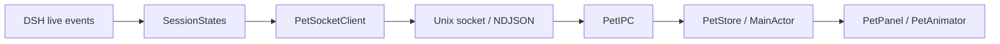

# 架构

DSH 公开 `session` / `agent` 事件进入 [bridge](../bridge/src/index.ts)，由会话 reducer 维护工具和审批集合。
客户端把最新来源快照编码为 NDJSON，经本地 Unix socket 交给 Swift IPC 解码器。
IPC 串行队列通过主队列 FIFO 提交给 `PetStore`，再由 AppDelegate 更新原生窗口、菜单和动画。

SwiftPM 的 `PetCore` 只依赖 Foundation，`PetIPC` 依赖 Core、Darwin 与 Dispatch，应用组合这两个模块并使用 AppKit、SwiftUI、Core Animation。
依赖边界由 [检查脚本](../scripts/check-boundaries.mjs) 和 Swift target 编译约束。

## 状态与生命周期

每次插件激活创建独立 sourceId；会话由来源与 sessionId 共同确定。
插件先订阅公开事件再枚举 live 会话，只补充尚未观察到的会话。
中途接入的运行任务保留粗粒度运行状态，已观察到的工具或审批才提供更具体反馈。

协议及边界样例的权威入口为 [schema](../contracts/bridge.schema.json) 和 [fixtures](../contracts/fixtures/)。
DSH 连接首条消息必须是快照，后续消息保持来源一致、序号递增。
首份快照建立静默基线，不重放旧完成反馈。
来源替换先移除旧连接状态再接收新基线，避免旧连接迟到关闭污染新状态。

聚合时优先显示等待处理，其次为仍在执行或思考的任务，最后显示短暂结果反馈和待机。
审批展示有 300 ms 门槛，短时自动决定不闪烁等待姿态。
完成会庆祝，错误显示受挫；取消、受阻、输出上限和其他结束使用中性姿态及各自文字。

DSH 事件回调不等待 socket 写入，背压期间仅保留最新快照。
应用失联不影响 DSH 任务；插件重连后发送当前快照。
心跳和失联清理由 IPC 边界负责，退出时释放连接、计时器和 socket。
窗口使用单实例锁，重复启动退出第二实例。

用户偏好保存在 UserDefaults；任务状态只存在内存。
传输内容仅含来源、会话标识、计数和任务状态，不包含聊天正文或凭据。

## 角色资源与播放

菜单或设置修改 `PetPreferences.skin`，AppDelegate 用同一份 PetStore 呈现状态选择对应主题资源。
PetView 在角色变化时使当前姿态缓存失效，保证同一 working 状态也会立即替换素材。
角色切换不重建 IPC，不清空任务状态。

小女孩使用透明 PNG 与 CALayer 轻动画。
DSH Pet 使用 AVQueuePlayer、AVPlayerLooper 和透明 AVPlayerLayer 播放原始 HEVC-with-Alpha MOV。
视频就绪前显示对应 PNG 首帧；首个视频帧就绪后移除底图，避免两个透明人物重叠。
隐藏、关闭动画、系统暂停或切回小女孩时停止播放并释放队列、循环器、观察者和视频图层。
已释放播放实例的迟到回调按实例标识丢弃。

主题 manifest 定义可见包络、脚底锚点和可选人物参考高度。
DSH Pet 以 idle 人物高度为尺度，所有动画采用共同包络，保持动作切换时人物比例稳定。
窗口根据包络预留特效空间，屏幕脚底坐标在切换前后保持一致。

## 多宿主接收与提醒

Codex 与 Claude Code 的原始 hooks 由 PetHooks adapter 转换为 PetActivityEvent，短命 helper 通过同一 Unix socket 一次性交付。
DSH 快照仍按长连接与心跳管理；activity 连接退出不触发会话清理，会话生命周期由 PetStore 管理。
来源与会话共同确定身份，回合标识阻止旧回合污染新状态，工具标识处理并行与乱序结果。
长时间没有新事实的 hook 会话标记为状态待确认。

PetStore 保留来源标签并分别计算当前呈现与一次性 PetNotice，避免其他执行任务遮蔽完成提醒。
AppDelegate 每次刷新通过 PetNotificationDispatcher 消费提醒，生产使用 UserNotifications adapter，联合测试使用录制 adapter。
系统通知权限或开关不影响桌宠显示；自动化入口不写用户偏好。

原始 hooks 是 True external 依赖，测试先通过原始事件与真实本地 IPC 验证 adapter，再用真实宿主加本地确定性模型验证事件触发。
契约定义见 contracts/bridge.schema.json，安装入口见 scripts/install-hooks.py。
