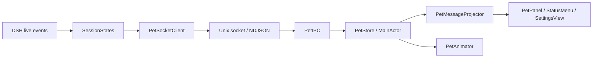

# 架构

DSH 公开 `session` / `agent` 事件进入 [bridge](../bridge/lib/index.js)，由会话 reducer 维护工具和审批集合。
插件源码位于 [hotheat/dsh-native-pet-plugin](https://github.com/hotheat/dsh-native-pet-plugin)，本仓库以 submodule 跟踪同一份实现。
客户端把最新来源快照编码为 NDJSON，经本地 Unix socket 交给 Swift IPC 解码器。
IPC 串行队列通过主队列 FIFO 提交给 `PetStore`，再由应用层 PetMessageProjector 投影文案，AppDelegate 应用到原生窗口、菜单和动画。

SwiftPM 的 `PetCore` 只依赖 Foundation，`PetIPC` 依赖 Core、Darwin 与 Dispatch。
`PetHooks` 转换宿主输入并通过 IPC 投递，`PetHookCLI` 提供一次性 helper 入口。
应用组合 Core 与 IPC，使用 AppKit、SwiftUI、Core Animation。
依赖边界由 [检查脚本](../scripts/check-boundaries.mjs) 和 Swift target 编译约束。

## 状态与生命周期

每次插件激活创建独立 sourceId；会话由来源与 sessionId 共同确定。
插件先订阅公开事件再枚举 live 会话，只补充尚未观察到的会话。
中途接入的运行任务保留粗粒度运行状态，已观察到的工具或审批才提供更具体反馈。

协议及边界样例的权威入口为 [schema](../contracts/bridge.schema.json) 和 [fixtures](../contracts/fixtures/)。
协议 v1 允许缺省 `v` 或整数 `v: 1`，解码器忽略未知可选字段，保留必需键、类型、枚举、范围、大小和身份校验。
DSH 插件和 hook helper 输出不带 `v` 的消息。
会话快照的可选 `title` 来自 `session/title` 实时事件与 `sessionProjections` 的 `title` 初始投影；投影服务缺失时继续接收事件。
activity 的可选 `label` 来自 hook 输入 `cwd` 的末级目录，完整路径不进入协议。
两字段均接受字符串或 null，缺字段时归一为 null。
生产者和解码器均去除 Unicode Cc/Cf 字符、trim 首尾空白，再按 Unicode 标量（码点）截断到 256，空串归一为 null。
归一化入口为 JS 的 `bridge/lib/text.js` 与 Swift 的 `PetCore/PetWireText.swift`，hook 的 cwd label 也使用同一规则。
[schema](../contracts/bridge.schema.json) 的 `maxLength: 256` 表示生产者输出的码点上限；解码器对超限 title/label 截断，保留整条消息，不使用字段字节上限。
有效 fixtures 的 `normalized` 记录完整归一化 wire 消息，含 null 字段，剥离 v 和未知字段；JS 比较对象，Swift 重新编码为键排序的 canonical JSON 后比较，双份 fixtures 逐字节校验。
DSH 标题由宿主按提示词生成，可能含提示词摘要；气泡和设置使用标题，系统通知中的标题显示由默认关闭的偏好控制。
未知版本由 decoder 抛出 `unsupportedVersion`，IPC 在换行帧和 EOF 末帧经 `onIncompatible` 报告后关闭该 client。
提示通过 dispatcher 写入 `PetStatusModel.protocolWarning`，在菜单和设置显示，保持到进程退出。
它独立于连接错误和 PetStore，其他来源及桌宠文字继续正常呈现。
DSH 连接首条消息必须是快照，后续消息保持来源一致、序号递增。
首份快照建立静默基线，不重放旧完成反馈。
来源替换先移除旧连接状态再接收新基线，避免旧连接迟到关闭污染新状态。

聚合时优先显示等待处理，其次为仍在执行或思考的任务，最后显示短暂结果反馈和待机。
DSH bridge 执行一次 300 ms 审批去抖，Swift 收到非基线 waiting 快照立即排队提醒。
连续 waiting 只提醒一次，离开后重新进入 waiting 可再次提醒；基线 waiting 保持静默。
Hook waiting 仍由 Swift 执行 300 ms 去抖。
完成会庆祝，错误显示受挫；取消、受阻、输出上限和其他结束使用中性姿态及各自文字。

DSH 事件回调不等待 socket 写入，背压期间仅保留最新快照。
应用失联不影响 DSH 任务；插件重连后发送当前快照。
心跳和失联清理由 IPC 边界负责，退出时释放连接、计时器和 socket。
窗口使用单实例锁，重复启动退出第二实例。
IPC 启动失败经统一 fail/shutdown 路径退出，避免留下无锁实例。

用户偏好保存在 UserDefaults；任务状态只存在内存。
传输内容包含来源、会话标识、可选会话标题、计数和任务状态，不包含聊天正文或凭据。

## 角色资源与播放

菜单或设置修改 `PetPreferences.skin`，AppDelegate 用同一份 PetStore 呈现状态选择对应主题资源。
PetView 在角色变化时使当前姿态缓存失效，保证同一 working 状态也会立即替换素材。
角色切换不重建 IPC，不清空任务状态。

小女孩使用透明 PNG 与 CALayer 轻动画。
DSH Pet 使用 AVQueuePlayer、AVPlayerLooper 和透明 AVPlayerLayer 播放原始 HEVC-with-Alpha MOV。
视频就绪前显示对应 PNG 首帧；首个视频帧就绪后移除底图，避免两个透明人物重叠。
隐藏、关闭动画、系统暂停或切回小女孩时停止播放并释放队列、循环器、观察者和视频图层。
已释放播放实例的迟到回调按实例标识丢弃。

主题 manifest 定义可见包络、脚底锚点和可选人物参考高度。
DSH Pet 以 idle 人物高度为尺度，所有动画采用共同包络，保持动作切换时人物比例稳定。
窗口根据包络预留特效空间，屏幕脚底坐标在切换前后保持一致。

## 多宿主接收与提醒

Codex 与 Claude Code 的原始 hooks 由 PetHooks adapter 转换为 PetActivityEvent，短命 helper 通过同一 Unix socket 一次性交付。
DSH 快照仍按长连接与心跳管理；activity 连接退出不触发会话清理，会话生命周期由 PetStore 管理。
C4 保留两种输入：快照可在重连时建立基线，并在背压时合并为最新状态；hook 事实不可合并，丢失单个事件可能改变回合、工具或提醒状态。
统一为原始事实会改变上述交付与重连语义，因此当前不执行该改造。
C6 暂缓：目前只有 Codex 与 Claude Code 两个宿主 adapter；接入第三个宿主时再评估宿主登记表，避免为两个已知目标先造 registry。
来源与会话共同确定身份，回合标识阻止旧回合污染新状态，工具标识处理并行与乱序结果。
已有 turnID 的会话只由 `turnStarted` 切换回合；只有 SessionStart 的会话可由任意首个带 turnId 的事件建立回合。
陌生回合的其他事件直接丢弃，也不刷新接收时间；因此丢失新回合的 turnStarted 会丢失该回合的后续状态和提醒。
同回合非终态继续校验 phaseOccurredAt；终态事实不受该阶段时间门槛限制，并保留阶段时间的最大值。
Stop 后同回合、时间不早于 Stop 且通过阶段时间校验的活动会清除结果与该会话反馈，恢复执行；后续 Stop 再次提醒。
没有中间活动的重复 Stop 只更新状态；失败和中断保持终态直到新回合，工具失败只结束该工具。
Hook 时间戳来自 helper 接收时间，缺少宿主全序，极晚到达的旧活动仍可能被当作续跑。
非终态 hook 会话在 900 秒无新事实后标记为状态待确认。
终态不会 stale，900 秒后退出呈现列表和 connectedSources，内存去重状态仍按 24 小时规则清理。
全部历史退出后的空状态继续使用“未连接宿主”或“暂无宿主状态”。

PetStore 保留来源标签并分别计算当前呈现与一次性 PetNotice，避免其他执行任务遮蔽完成提醒。
提醒队列保留整批合法提醒；event、tool、retiredTurn、session 和输入字节上限仍由现有实现限制。
`PresentedSession` 持有 `session: SessionSnapshot` 与来源标识、来源标签、isStale，标题与计数从 session 读取。
`PetPresentation` 提供姿态、计数、会话、hasReceivedHook 和可选 feedback；hasReceivedHook 区分尚未连接宿主与 hook 历史退出后的就绪状态。
`PresentedFeedback` 只携带 pose、kind、sourceLabel、title，snapshot 和 hook 都填来源标签。
`PetFeedbackKind` 区分 completed、failed、interrupted、blocked、maxTokens、other，Core 不包含用户文案。
`PetNotice` 保留通知身份、来源、会话、kind、feedback、sessionTitle 与 turnDuration；waiting 的 feedback 为 nil，其他通知携带对应结果种类。

应用层 [PetMessageProjector](../native/Sources/DSHNativePet/Presentation/PetMessageProjector.swift) 是气泡、菜单/设置摘要、会话行和通知正文的文案来源。
[PetStatusModel](../native/Sources/DSHNativePet/Presentation/PetStatusModel.swift) 维护可观察状态，委托 projector 生成摘要与会话行；SettingsView 只呈现视图。
AppDelegate 更新 lastActivity 后，将 presentation、时间与交互标志交给 [PetPoseDecision](../native/Sources/DSHNativePet/PetPoseDecision.swift)，按 idle 满 60 秒睡眠、poke、drag、demo 的顺序覆盖姿态。
最终 pose、气泡宽度与 connectionError 传给 projector；动画开关、系统挂起与 demo 文字覆盖由 AppDelegate 应用。
带标题的等待与完成气泡由 projector 调用原有 `Presentation/PetBubbleFit`，以 11pt 字体和扣除内边距的文本宽度测量，按 grapheme 边界裁剪标题并保留状态。
完成统一为“本轮回应已结束”，带标题时为“「标题」已完成”；无标题反馈中，失败与受阻的正文已含来源，其余结果使用来源前缀；并行完成使用来源/标题与剩余活动两行排版。
设置会话行优先显示标题；通知默认标题为“宿主标签 会话提醒”。
设置中的“在通知中显示会话标题”对应 `pet.notificationSessionTitle`，默认关闭，自动化模式沿用 persistChanges 禁止写入偏好。
开启后，PetStore 随四类 PetNotice 传递会话标题，AppDelegate 将偏好传给 dispatcher，再由 projector 将非空标题扁平化并按现有 40 字上限截断，通知标题行显示“宿主标签 · 会话标题”。
无标题时保留默认标题；通知正文、声音与时长过滤、userInfo/threadIdentifier 和点击定位保持原有行为。

AppDelegate 每次刷新通过 PetNotificationDispatcher 消费提醒，dispatcher 保留开关、时长过滤和声音策略，再调用 projector 生成 [PetNotificationContent](../native/Sources/DSHNativePet/Presentation/PetNotificationContent.swift)。
content 包含 id、kind、title/body、sound、threadIdentifier、userInfo，并保留 sourceLabel 供 capture 日志使用。
系统 adapter 只把投影内容映射为 UserNotifications 请求，录制 adapter 保存相同 content，并在 JSONL 中记录声音、threadIdentifier、userInfo 及原有身份字段。
`PetStore.nextDeadline(after:)` 驱动 hook 等待去抖和反馈到期的精确单次刷新，不依赖 1 秒定时器。
系统通知只在等待和出错时发声；通知携带 sourceId / sessionId，点击后经 AppDelegate 打开设置并定位会话行。
系统通知权限或开关不影响桌宠显示；自动化入口不写用户偏好。

宿主事件与真实 IPC、真实宿主加确定性模型的验证入口见 [开发指南](development.md)。
[安装器](../scripts/install-hooks.py) 将 helper 复制到目标目录中的临时文件，设置 0700 权限后原子替换，失败保留旧文件。
正常启动应用时，`HelperSync` 将过期的已安装 `pet-hook` 原子替换为应用附带的 helper。

## 自动化与 capture

AppDelegate 集中判断自动化模式，在资源加载、通知 adapter、窗口和 IPC 之前校验缺值及参数组合。
自动化使用录制通知 adapter，并关闭偏好写入。
[Capture extension](../native/Sources/DSHNativePet/AppDelegate+Capture.swift) 负责截图与最小证据输出，仍编译进 release。
[原生 E2E](../bridge/e2e/native-app.e2e.mjs) 负责三帧换肤的脚底坐标、尺寸偏好和首尾窗口 frame 断言。
视频截图保留实际解码帧、播放时间及透明/不透明像素证据。
