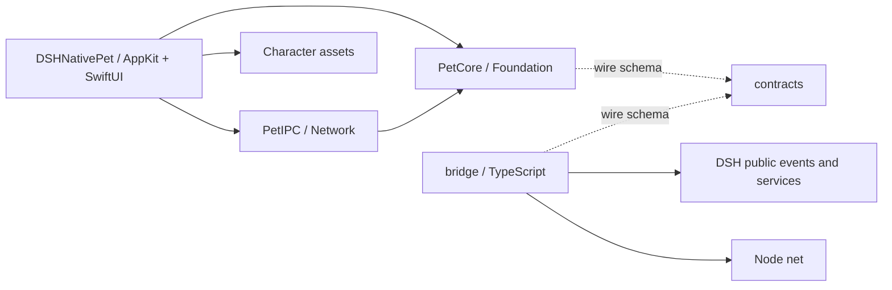
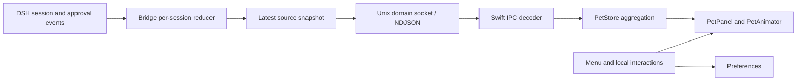

# Implementation Plan: DSH Native Pet

**Delivery**: single PR (plan and implementation)。
计划与实现共用 `feat/native-desktop-pet` 分支。
当前已进入本地实现与产物交付阶段，不提交、推送或创建 PR。
实现和验收状态以末尾 Execution Evidence 及 `docs/acceptance.md` 为准。

## Overview

为 `hotheat/dsh-native-pet` 实现一个由 DSH 实际任务状态驱动的 macOS 原生桌宠。
Swift AppKit 负责悬浮窗口、交互和角色动画，独立的 TypeScript / Cordis 插件负责观察 DSH 并传递精简状态。
角色沿用 `two-head-q-girl`，优先复用造型参考，通过 Codex 图像生成补齐透明素材，再用 Core Animation 实现轻量动作。

仓库描述采用：`Native macOS desktop pet for DeepSeek Harness, built with Swift and AppKit.`

## Requirements

- 桌宠使用 Swift、AppKit 和 Core Animation；设置与状态面板使用 SwiftUI。
- 提供透明、可拖动、可调整大小的悬浮窗口，普通点击和拖动不抢走当前编辑器的键盘焦点。
- 实现待机、思考、处理工具、等待确认、完成、错误、休息，以及点击和拖动反馈。
- 通过真实 DSH 会话事件驱动状态，正确处理并行工具、多会话、取消、断线和重连。
- 桥接采用标准 DSH bundle；兼容性验收以当前实际安装的 DSH 为准，不实现多代接口兼容层。
- DSH Web profile 和官方 Desktop profile 分别验证安装与事件到达，不能以 Web 成功推断 Desktop 成功。
- 插件只观察任务和审批事件，网络或 IPC 故障不能延迟或改变 DSH 执行结果。
- 提供菜单栏入口，包含显示/隐藏、点击穿透开关、大小、动画开关、连接状态和退出。
- 应用可独立启动；尚未连接 DSH 时仍可交互，并明确显示“未连接 DSH”。
- 打包为可移动运行的 `.app`；首先交付本机可验证构建，公开签名分发单独处理。

## Non-goals

- Windows/Linux、远程 DSH、浏览器内桌宠和移动端。
- 代替 DSH 进行聊天、执行命令、批准工具或自动回答用户问题。
- 余额记账、第三方模型接入、皮肤市场、自动更新和自动安装 DSH。
- 首版完整复刻鲸鱼娘的 34 段动画、桌面漫游、窗口攀爬、全局鼠标跟踪或 Live2D。
- 修改 `deepseek-harness` 和 `hanzi-evolution-atlas`；两者仅作为接口和素材证据来源。

## Open Decisions

- **Critical**：没有需要用户补充后才能开始本地实现的产品决策。
- **Important**：默认验收平台为本机 Apple Silicon、macOS 15；Swift Package 的 deployment target 先按 macOS 15 设置。
  扩展到其他系统或芯片时另行定义并验证支持范围。
- **Important**：首版默认显示全部已连接 DSH 来源的聚合状态，状态菜单列出各会话；不依赖当前浏览器标签页或 UI 选中会话。
- **Important**：点击穿透先提供显式的整窗开关，始终可通过菜单栏恢复交互。
  不把任意透明像素自动穿透作为首版承诺。
- **Important**：公开发行前仍需确定应用签名身份和项目许可证。
  这两项不阻塞本地构建和功能验证，也不在本轮修改远端仓库描述或许可证。
- **Technical gate**：Phase 1 必须先验证 Swift Network.framework 与 Node `net` 的 Unix domain socket 互通，再固化 IPC 实现。
  实际 Swift Network Unix endpoint 与 Node net 双进程互通已通过，继续采用单一 Unix socket 方案。

## Architecture Changes

### Current Evidence

以下为 2026-10-23 计划制定时的证据快照。
当前交付状态见 Execution Evidence。

| 对象 | 已核实事实 | 设计影响 |
| --- | --- | --- |
| 目标仓库 | `hotheat/dsh-native-pet` 本地只有 `.git`，尚无提交 | 全部产品文件为新增，无迁移和旧调用方 |
| 本机环境 | macOS 15.6.1、Swift 6.1.2、Xcode 路径有效，`dsh --version` 为 `0.2.1-rc.2` | 有本地编译条件；应用运行和插件加载仍待验收 |
| DSH 源码 | 检查基线 `687f282e8625c6b8d11ff58211a90524be2e4317` | 从已核实的公开事件与服务接入 |
| 会话事件 | `session/created`、`session/event`、`session/disposed`，公开 `ctx.sessions.list()`；agent 提供公开 `running/idle` 状态 | 插件只读订阅，不扫描日志文件 |
| 任务结束 | `TurnEndReason` 区分 `completed`、`aborted`、`blocked`、`error`、`max-tokens` 等 | 只有真实完成触发庆祝；取消、阻断、失败分别处理 |
| 审批 | `approval/asked` 与 `approval/decided` 成对写入会话事件 | 可显示等待确认，无需注册审批回答器 |
| Clawd 桥接 | DSH 事件经桥接发送给独立桌宠，参考基线 `190568c5b6178900c1b4481dd4619b91a39b1cfe` | 复用职责划分，不复制审批接管和跨平台恢复逻辑 |
| 鲸鱼娘 | 主题包含动作状态、脚底基线、每姿态布局与点击区域；发布包有 34 个透明 WebP 动画 | 参考状态到姿态映射和锚点，使用自己的角色资源 |
| 小女孩素材 | 全身图 1086×1448；8 张表情均 941×1672，均无 alpha | 需要透明化和锚点对齐，不能当作现成逐帧动画 |

DSH 的 `Session.eventAt()`、`snapshotEvents()` 已标记禁止新增调用。
插件初始化使用公开的 live registry 和运行状态；重连使用插件自己的当前快照，不依赖这些同步历史读取接口。

本机 DSH 仓库存在 UI Markdown 相关未提交改动，本任务不触碰这些文件。

### Target Directory Structure

以下为 `dsh-native-pet` 的完整受影响目录树。
所有列出的产品文件均为新增；`lib/`、`.build/`、`dist/`、`work/` 为构建或验证产物，不手动维护、不提交。

```text
dsh-native-pet/
├── README.md                              # 安装、启动、支持范围和使用入口
├── .gitignore                             # 构建、缓存和测试运行数据
├── .github/workflows/check.yml            # Swift、插件、协议和资源检查
├── native/
│   ├── Package.swift                      # Swift targets 与依赖边界
│   ├── Info.plist                         # 菜单栏应用元数据
│   ├── Sources/
│   │   ├── PetCore/
│   │   │   ├── BridgeMessage.swift        # IPC 数据模型和边界解码
│   │   │   ├── PetState.swift             # 会话状态、连接状态和姿态标识
│   │   │   ├── PetStore.swift             # 来源快照、多会话聚合、短暂反馈
│   │   ├── PetIPC/
│   │   │   ├── UnixSocketServer.swift     # 本地监听、连接生命周期和帧接收
│   │   │   └── RuntimeDirectory.swift     # socket、单实例锁和受控清理
│   │   └── DSHNativePet/
│   │       ├── main.swift                # NSApplication 入口
│   │       ├── AppDelegate.swift          # 组合 core、IPC、窗口与菜单
│   │       ├── PetPreferences.swift       # 大小、位置、可见性和动画偏好
│   │       ├── PetPanel.swift             # 非激活透明面板、拖动和屏幕约束
│   │       ├── PetView.swift              # NSImageView/CALayer 渲染与命中区域
│   │       ├── PetAnimator.swift          # 姿态、变换、动画暂停和一次性反馈
│   │       ├── PetAssets.swift            # 资源 manifest、锚点、图片加载
│   │       ├── StatusMenu.swift           # 菜单栏入口和连接摘要
│   │       ├── SettingsView.swift         # SwiftUI 偏好与会话状态展示
│   │       └── Resources/Character/
│   │           ├── manifest.json         # 姿态资源、画布、基线和交互区域
│   │           ├── idle.png
│   │           ├── thinking.png
│   │           ├── working.png
│   │           ├── waiting.png
│   │           ├── completed.png
│   │           ├── error.png
│   │           ├── sleeping.png
│   │           ├── poke.png
│   │           └── drag.png
│   └── Tests/
│       ├── PetCoreTests/
│       │   ├── ContractTests.swift
│       │   └── PetStoreTests.swift
│       ├── PetIPCTests/
│       │   └── UnixSocketServerTests.swift
│       └── PetAppTests/
│           ├── PetPanelTests.swift
│           └── PetAssetsTests.swift
├── bridge/
│   ├── package.json                       # npm 包 dsh-native-pet，bundle 入口
│   ├── package-lock.json                  # 包管理器生成
│   ├── tsconfig.json
│   ├── cordis.patch.yml                   # 标准 DSH Host 插件挂载
│   ├── src/
│   │   ├── index.ts                       # apply(ctx)、订阅和 ctx.effect 清理
│   │   ├── protocol.ts                    # wire 类型和快照构造
│   │   ├── session-state.ts               # DSH 事件到会话状态的纯 reducer
│   │   └── socket-client.ts               # Node net、重连、背压和心跳
│   └── tests/
│       ├── contract.test.ts
│       ├── session-state.test.ts
│       ├── lifecycle.test.ts
│       ├── socket-client.test.ts
│       └── dsh-host.e2e.test.ts            # 真实 DSH Host + 可控 provider
├── contracts/
│   ├── bridge.schema.json                 # 唯一 wire 字段与枚举规范
│   └── fixtures/
│       ├── snapshots.json                 # 合法快照、心跳和状态序列
│       └── invalid-messages.json          # IO 边界反例
├── designs/two-head-q-girl/
│   ├── IP_DNA.md                          # 原角色规范的任务内引用副本
│   ├── references/
│   │   ├── front-full-body.png            # 造型参考，非运行时资源
│   │   └── three-view.png                 # 结构参考，非运行时资源
│   ├── prompts.md                        # Codex 生图/编辑要求和每个姿态说明
│   └── asset-sources.json                 # 来源、生成记录、选定资源哈希
├── scripts/
│   ├── check-boundaries.mjs               # 限定路径的依赖检查
│   ├── check-contracts.mjs                # 共享 JSON fixtures/schema 检查
│   ├── validate-assets.swift              # alpha、尺寸、manifest 与边界检查
│   ├── package-app.sh                     # SwiftPM 编译并组装 .app
│   ├── smoke-ipc.mjs                      # Node 到实际 Swift 进程的互通
│   └── smoke-package.sh                  # 移动 .app 后启动和资源检查
└── docs/
    ├── plans/2026-10-23-native-desktop-pet.md
    ├── architecture.md                    # 实现后的边界和运行链路
    ├── development.md                     # 构建、隔离 DSH 环境和测试
    ├── assets.md                          # 资源制作、替换和验收方法
    └── acceptance.md                      # 人工 UI/E2E/性能验收与实测记录
```

### File Change Map

| Current path | Target path | Operation | Responsibility and affected references |
| --- | --- | --- | --- |
| 空仓库 | `native/Package.swift`、`native/Info.plist` | 新增 | 定义 Swift 模块、应用元数据；供构建、测试和打包使用 |
| 无 | `native/Sources/PetCore/` | 新增 | 纯状态和协议模型；供 IPC、应用与契约测试消费 |
| 无 | `native/Sources/PetIPC/` | 新增 | 仅拥有本地连接和运行目录；调用 core 解码，不访问 UI |
| 无 | `native/Sources/DSHNativePet/`、`native/Tests/` | 新增 | 原生桌面体验、资源和平台测试；由 AppDelegate 组合 |
| 无 | `bridge/` | 新增 | Host 插件、事件归一化、连接生命周期；独立 npm 打包 |
| 无 | `contracts/` | 新增 | Swift 与 TypeScript 共用的协议事实和测试样本 |
| hanzi 仓库 `designs/ip-assets/two-head-q-girl/` | `designs/two-head-q-girl/` | 选择性复制参考文件 | 保留来源和身份锚点；源仓库不修改，产品不引用外部绝对路径 |
| 原始表情参考或 Codex 输出 | `native/Sources/DSHNativePet/Resources/Character/` | 新增运行时素材 | 经检查的透明独立姿态；与源图分离，manifest 供渲染和验证消费 |
| 无 | `scripts/`、`.github/workflows/check.yml` | 新增 | 协议、边界、资源和包的自动检查 |
| 无 | `README.md`、`.gitignore`、`docs/` | 新增 | 使用、开发和验收入口；计划与实际实现状态分开表述 |

没有文件移动、删除或既有调用方迁移。
下列实施范围已落盘，实际文件与小幅路径调整见 Execution Evidence。

### Module Responsibilities and Interfaces

| Module/path | Current responsibility | Proposed responsibility and public interface | State/resource owner |
| --- | --- | --- | --- |
| `bridge/src/index.ts` | 无 | `apply(ctx)` 订阅公开事件、初始化已存在的 live 会话、注册卸载清理 | Cordis 插件生命周期 |
| `bridge/src/session-state.ts` | 无 | `reduceSessionEvent()`、`createSnapshot()`；保持 turn、工具调用集合、审批集合 | 每个 DSH 插件实例的内存状态 |
| `bridge/src/socket-client.ts` | 无 | `start()`、`publish(snapshot)`、幂等 `stop()`；不等待远端确认后才释放 DSH 回调 | 一个客户端连接、心跳和重连计时器 |
| `contracts/bridge.schema.json` | 无 | 定义 `snapshot`、`heartbeat` 和字段限制；两端共同遵守 | 当前实施者维护规范与 fixtures |
| `native/Sources/PetIPC/` | 无 | `start(onMessage:onDisconnect:)`、幂等 `stop()`；把解码结果交给 core | socket、单实例锁、连接与缓冲区 |
| `native/Sources/PetCore/PetStore.swift` | 无 | `apply(snapshot)`、`disconnect(sourceID)`、`presentation(at:)` | 来源状态、聚合结果、反馈去重和到期时间 |
| `native/Sources/DSHNativePet/AppDelegate.swift` | 无 | 创建和关闭各组件，把 IPC 事件提交到 MainActor | 应用级组合和终止路径 |
| `PetPanel`、`PetView`、`PetAnimator` | 无 | `render(presentation)` 和本地交互；窗口/动画不生成任务事实 | NSPanel、图层、图片缓存、动画回调 |
| `PetPreferences`、`SettingsView` | 无 | 只保存大小、显示位置、动画与穿透偏好 | UserDefaults；执行状态不落盘 |

### Architecture and Dependency Direction

下图实线箭头表示静态代码依赖；虚线表示遵循共享数据规范。
这是新项目，所有边均为新增，没有旧依赖反转。



允许 `DSHNativePet -> PetIPC/PetCore`、`PetIPC -> PetCore` 和 `bridge -> DSH public API/node:net`。
禁止 `PetCore -> AppKit/SwiftUI/Network`、`PetIPC -> DSHNativePet`，以及 `bridge` 导入 DSH 私有源码、访问其数据库或解析日志文件。
SwiftPM target 依赖和编译检查约束 native 边界；`check-boundaries.mjs` 只扫描上述目录的 import 与明确禁用的历史读取调用。
不在全仓禁止通用标识符，也不把测试 fixture 的事件名称当作违规。

运行时箭头表示数据流，与上图静态依赖分开。



### Runtime and State Flow

1. 用户启动 `.app`，AppDelegate 初始化偏好、状态、菜单、面板和 IPC listener。
   listener 成功后接收插件连接；失败时菜单显示具体问题，退出走同一清理路径。
2. DSH 挂载 Host 插件，通过 `ctx.inject(['sessions', 'agents'], ...)` 等待所需服务，先订阅 live 事件，再枚举 `ctx.sessions.list()` 与对应 `ctx.agents` 的公开运行状态，避免枚举和订阅之间漏事件。
   枚举只补齐尚未建档的会话，不能覆盖 live 事件已经建立的精确状态。
   `running` 但尚未观察到当前 turn 的会话标记为 `running`，界面显示“任务进行中”，不推断其当前工具或审批。
   同时观察 `agent/status`，处理没有已观察 turn 的运行/空闲变化；不让较晚的 `idle` 通知提前覆盖刚收到的完成或错误反馈。
3. 插件把每个会话的事件折叠为状态，只发送最小状态字段，不发送提示词、模型回复、工具参数、审批正文或密钥。
4. 事件回调同步更新内存后结束；异步发送最新快照。
   发送背压时只保留一个最新待发快照，不建立随任务长度增长的事件队列。
5. Swift 按来源替换快照，再计算桌宠姿态、运行数量和简短气泡。
   UI 更新统一在 MainActor；窗口不反向修改 DSH。
6. 连接断开后立即将该来源标记为离线，排除其活动计数并显示断线提示。
   离线不等于任务结束，不能触发庆祝。
7. 重连先发送完整当前快照，恢复仍在运行的状态。
   首份快照只建立基线，不播放离线期间的旧完成反馈。
8. DSH 插件卸载释放订阅、计时器与连接；原生应用退出停止 listener、所有连接、动画和观察器，只清理自己持有的运行资源。

### IPC Contract

拟采用本机 Unix domain socket 和按行分隔的 UTF-8 JSON。
Swift 使用 Network.framework，Node 使用内置 `node:net`；Phase 1 完成真实互通和清理验证后才进入 UI 实施。

- 默认运行目录：`~/Library/Application Support/dsh-native-pet`。
- `pet.sock` 和单实例锁由原生应用拥有，目录权限限制为当前用户。
- 测试通过 `DSH_NATIVE_PET_RUNTIME_DIR` 指向临时目录；两端一致使用该路径。
- 创建 socket 前检查 macOS 路径长度约束，超长时报告实际配置问题。
- 单实例锁保护 socket 清理，第二个实例不删除第一个实例正在使用的 socket。
- 一行一条完整消息；接收端处理分片、粘包、无效 JSON、超长行和 EOF。
- 每帧上限初定 256 KiB，限制在 IO 边界，超限会话快照须报告问题而非静默截断。
- `snapshot` 含 `sourceId`、单调递增 `seq`、来源展示标签和完整 `sessions` 数组。
- `sourceId` 每次插件激活生成，避免不同进程或 profile 的相同 session id 冲突。
- 会话记录包含 `sessionId`、当前 `turn`（未知时为空）、`phase`、运行工具数量、待审批数量，以及最近终止结果的稳定标识。
- `phase` 为 `idle/running/thinking/working/waiting/completed/error/stopped`；`sleeping` 属于本地展示状态。
- 会话销毁通过下一份完整快照移除记录，避免 tombstone 协议和历史列表长期积累。
- `heartbeat` 只确认来源活跃，不推进任务；初定 5 秒一次，15 秒无消息判定失联。
- 重连间隔逐步增加至最多 5 秒；socket 关闭立即通知离线，心跳处理进程卡住但连接未关闭的情况。
- 相同来源连接替换时，旧连接后续的关闭回调不能删除新连接的状态。
- 首版协议不设计版本协商、升级回退或多套解析路径；两端随同一仓库实施。

正常退出、用户取消连接、心跳超时和启动失败汇合到单一 `finish(reason)` 清理路径。
该路径执行一次，重复 `stop/cancel` 无副作用；迟到回调不能重新发布状态或重建连接。
测试必须覆盖首次连接失败、重复取消、超时与关闭竞态、HMR 重载和退出后无残余计时器。

### Event Mapping and Aggregation

| DSH 输入 | 会话状态更新 | 桌宠效果 |
| --- | --- | --- |
| 首次接入已在运行的 agent | `running`，工具/审批细节未知 | 工作姿态，文字为“任务进行中” |
| `turn/start` | 新 turn，清空上轮集合和反馈，进入 `thinking` | 思考 |
| `tool/call` | 按 `event.data.callId` 加入活动集合 | 无待审批时为 `working` |
| `tool/result` | 按 `event.data.message.toolCallId` 移除对应调用，其他并行调用继续保留 | 完整观察了当前 turn 时，集合清空且 turn 未结束才回到思考 |
| `approval/asked` | 按 `event.data.id` 加入等待集合 | 持续等待超过 300 ms 才展示 `waiting`，提示“有审批请求待处理” |
| `approval/decided` | 移除对应审批 id | 根据剩余审批、工具、turn 恢复状态 |
| `turn/end: completed` | `completed`，清空该 turn 的活动集合 | 每个结果标识最多播放一次庆祝 |
| `turn/end: error` | `error` | 短暂错误反馈 |
| `turn/end: aborted` | `stopped` | 显示“已停止”，不庆祝、不当成失败 |
| `turn/end: blocked/max-tokens` | `stopped`，保留归一化原因 | 显示“受阻”或“达到输出上限” |
| 其他扩展结束原因 | `stopped`，不宣称成功 | 中性“本轮已结束” |
| `session/disposed` | 删除该会话 | 重算其余会话状态 |

单次工具失败不直接等同于整个任务失败。
工具失败可显示短暂反馈，但后续 turn 仍按真实事件继续，最终结果由 `turn/end` 决定。
中途接入时，未见到 `turn/start` 的当前 turn 保留内部 `detailsKnown = false` 标记。
未配对的 `tool/result` 或 `approval/decided` 不创建负数计数，也不证明全部工具或审批已经结束；已知等待解除后恢复粗粒度 `running`。
下一次 `turn/start` 才建立完整的回合内集合，`turn/end` 或明确的 agent 空闲状态结束此前的粗粒度忙碌。
审批事件在回合内可快速成对出现，300 ms 内已决定的审批取消等待反馈，不能把自动通过也显示为需要用户处理。
审计事件只能证明请求尚未决定，不能证明一定需要人工确认；界面提供去 DSH 查看状态的提示，不接管决定。
`ask_user_question` 的等待状态首版不单独推断；它仍是正在处理的工具，用户回答留在 DSH。

聚合顺序为：待审批 > 正在处理工具/粗粒度运行 > 正在思考 > 无活动时的新错误 > 无活动时的新完成 > 待机。
某会话完成时若其他会话仍运行，气泡提示完成、主体保持忙碌，并展示活动数量。
等待与工作并存时，菜单同时列出两种数量，避免把整个 DSH 表述为停住。
完成和错误反馈初定 3 秒；新活动立即覆盖已过时反馈。
无活动且桌宠自身 60 秒无交互后进入休息；不读取全局键盘或鼠标，不申请辅助功能权限。
隐藏、系统锁屏或休眠、用户关闭动画时暂停持续动画，唤醒后按当前状态恢复。

### Asset Plan

原始参考路径为 `/Users/jiaoguo/github/hanzi-evolution-atlas/designs/ip-assets/two-head-q-girl`。
它是制作输入，构建产物不依赖该绝对路径。

现有素材适合保持形象一致，但缺少透明背景、闭眼休息和专门工作/拖动姿态。
后续实施可直接使用用户已允许的 Codex 内置图像生成/编辑工具，无需另找鲸鱼娘图片替代角色。
本轮没有调用生图工具；素材生成属于 Phase 2。

| 目标姿态 | 优先参考 | 处理与动作 |
| --- | --- | --- |
| idle | `front-full-body.png` | 去背景、保留完整全身；原生轻微呼吸 |
| thinking | `expressions/03-thinking.png` | 透明编辑、统一站位；轻微倾斜 |
| working | 全身图 + 三视图 | 同角色专注姿态；短幅度规律动作，不新增复杂道具 |
| waiting | `expressions/02-surprised.png` | 温和提示姿态；轻微一次性强调 |
| completed | `expressions/06-thumbs-up.png` / `08-jump-celebrate.png` | 选定一张透明姿态；原生短跳跃后归位 |
| error | `expressions/04-pouting.png` | 克制的受挫反馈，不使用惩罚性动作 |
| sleeping | `expressions/07-sleepy-yawn.png` | 生成闭眼稳定休息姿态；深休息静止 |
| poke | `expressions/01-happy-wave.png` | 挥手或笑脸；一次性反馈 |
| drag | 全身图 + 三视图 | 保持服装和人体结构的拖动反应；不做夸张拉伸 |

制作约束：

- 编辑本地参考图之前先目视检查，明确原图是编辑目标还是身份参考。
- 使用图像工具的透明背景能力，不用代码绘制替代角色，也不用粗糙色键抠掉白色衣服。
- 每个状态生成独立单张 PNG，禁止让模型输出九宫格后当作动画帧。
- 保持黑色双丸子头、粉色发圈、白 T、斜背带、绿色口袋小狮子、花朵七分裤和赤脚。
- 以 1024×1024 透明逻辑画布为制作目标；实际输出必须检查，不假设提示词能保证像素尺寸。
- manifest 明确每姿态的原始尺寸、可见区域和脚底锚点，渲染时按逻辑画布对齐，避免切图造成抖动。
- 屏幕默认角色高度先取约 180 pt，支持 120-280 pt；这是原型参数，按实机观感校准。
- 不把整张静态图的缩放称作眨眼或骨骼动画；首版只承诺姿态切换和明确的位移/缩放动画。
- 后续需要真实眨眼或逐帧动作时，补对应资源与播放测试，再评估 SpriteKit；本计划不预埋第二套渲染器。
- 选定资源落入仓库，记录来源、生成提示词和哈希；临时候选保留在 `work/`，不能只引用工具缓存。

像素验收以实际截图为准：浅色、深色和复杂壁纸上均无米色方块、白边或裁切，普通状态切换的脚底漂移不超过 1 pt。
检查 1×/2× 显示缩放、小/中/大三种尺寸，以及点击区域与角色区域的重合。
持续动画保持少量 CALayer 变换，不用高频 SwiftUI 状态更新循环驱动静态姿态。

## Ownership Map

| Path | Owner |
| --- | --- |
| `native/Package.swift`、`PetCore/`、`PetIPC/`、`PetIPCSmoke/` 及 Core/IPC 测试 | `/root/native_core` |
| `native/Sources/DSHNativePet/*.swift`、`Info.plist`、`PetAppTests/` | `/root/native_ui` |
| `bridge/**`，包含 lockfile | `/root/review_state_design` |
| `contracts/**` | 主代理 `/root`，两端接口集成负责人 |
| `designs/**`、运行时角色资源 | `/root/assets` |
| `scripts/**`、`.github/**`、`.gitignore` | 主代理 `/root` |
| `README.md`、`docs/**` | 主代理 `/root` |

只读咨询不构成文件所有权转移。
本轮共享协议由主代理管理，资源 manifest 由素材代理管理，UI 按冻结格式读取。

## Implementation Steps

### Phase 1: Contracts and Native Window Feasibility

1. **建立最小工程与契约**（`native/Package.swift`、`bridge/package.json`、`contracts/`）。
   - Action：创建 Swift targets、TypeScript 构建/测试入口、标准 bundle patch；定义快照字段、共享 fixtures 和作用于 IO 的限制。
   - Why：两端先统一状态含义，避免后续 UI 和插件各自定义执行结果。
   - Expected result：两端解析同一组合法样本，并拒绝无效边界输入。
   - Verify：`swift test --package-path native --filter ContractTests`、`npm --prefix bridge test -- contract`、`node scripts/check-contracts.mjs`。
   - Dependencies：无；Complexity：中；Risk：中，DSH package metadata 需按当前宿主实测。

2. **验证 IPC 和非激活窗口**（`PetIPC/`、`PetPanel.swift`、`scripts/smoke-ipc.mjs`）。
   - Action：先让 Node 发送一份快照到实际 Swift listener，再验证透明 NSPanel 的拖动、层级和焦点行为。
   - Why：提前暴露本地连接、socket 清理和 macOS 窗口行为问题。
   - Expected result：真实跨进程数据可读；拖动桌宠后，原编辑器仍能继续输入。
   - Verify：IPC smoke；socket 重启/双实例/分片/背压测试；人工验证普通窗口、Spaces、全屏应用和多显示器。
   - Dependencies：步骤 1；Complexity：中；Risk：高，平台行为不能由单元测试替代。

### Phase 2: Character Assets and Rendering

3. **准备透明角色资源**（`designs/two-head-q-girl/`、`Resources/Character/`）。
   - Action：复制必要参考，编写姿态提示词，用 Codex 图像编辑优先复用已有表情，用图像生成补 working、sleeping、drag。
   - Why：现有图片无透明通道，无法直接达到桌宠显示要求。
   - Expected result：九个可独立展示的透明姿态，身份锚点一致，运行时 manifest 完整。
   - Verify：`swift scripts/validate-assets.swift`；逐张目视核对并在浅/深背景检查边缘。
   - Dependencies：步骤 2 确定显示尺寸和锚点；Complexity：中；Risk：高，生成质量可能需要定向返工。

4. **实现原生动画和交互**（`PetView.swift`、`PetAssets.swift`、`PetAnimator.swift`、`PetPanel.swift`）。
   - Action：加载选定姿态；实现呼吸、思考轻摆、完成短跳、点击反馈、拖动定位和停止动画；配置紧凑窗口与显式穿透开关。
   - Why：用少量原生动画获得稳定反馈，并控制常驻资源开销。
   - Expected result：切换姿态不漂移、不抢焦点，关闭动画后仍准确切换状态。
   - Verify：`PetAssetsTests`、`PetPanelTests`；真实截图比较与交互录像。
   - Dependencies：步骤 3；Complexity：中；Risk：中，图层动画取消和拖动结束必须归位。

### Phase 3: DSH State Bridge

5. **实现只读事件 reducer**（`bridge/src/index.ts`、`session-state.ts`）。
   - Action：使用 typed public events 观察会话、工具和审批；按 call id/approval id 维护集合；初始化已运行 agent；准确映射结束原因。
   - Why：确保角色动作对应真实状态，多工具并行不会提前显示完成。
   - Expected result：一次真实 turn 可依次驱动 thinking、working、waiting、completed/stopped/error。
   - Verify：reducer、生命周期测试；在隔离 DSH Host 中运行可控 provider 和工具的完整回合。
   - Dependencies：步骤 1；Complexity：中；Risk：中，回合结束原因可扩展，未知值不能按成功处理。

6. **实现重连、聚合和清理**（`socket-client.ts`、`PetStore.swift`、`UnixSocketServer.swift`）。
   - Action：发送来源快照与心跳；实现最新快照背压、多来源聚合、短暂反馈去重、失联移除和初次快照静默恢复。
   - Why：应用与 DSH 可以独立重启，多会话不会相互覆盖。
   - Expected result：桌宠重启后恢复现有任务，DSH 退出后不留下永久忙碌状态，插件故障不影响 DSH。
   - Verify：两个 Host 来源、两个会话、旧消息、丢连接、HMR、应用退出与重连竞态契约测试。
   - Dependencies：步骤 2、5；Complexity：高；Risk：中，来源替换和迟到回调需要精确测试。

### Phase 4: App Integration and Installation

7. **整合菜单、偏好和状态面板**（`AppDelegate.swift`、`StatusMenu.swift`、`SettingsView.swift`、`PetPreferences.swift`）。
   - Action：提供显示、大小、动画、穿透、连接摘要和退出；保存显示器标识与归一化位置，屏幕移除后限制到可见区域。
   - Why：用户可从菜单恢复隐藏/穿透的桌宠，重启后保持位置。
   - Expected result：菜单始终可用；断线、等待、取消信息可区分；设置窗口主动打开时可正常获得焦点。
   - Verify：多屏拔插、分辨率变化、系统休眠唤醒、菜单恢复和二次启动。
   - Dependencies：步骤 4、6；Complexity：中；Risk：中，显示器坐标与全屏 Space 行为需实机核对。

8. **打包应用与插件并验证安装**（`scripts/package-app.sh`、`smoke-package.sh`、`bridge/package.json`、`README.md`）。
   - Action：生成 `.app` 与插件 tarball；按 SwiftPM 实际资源 bundle 布局复制资源，移动包后验证 Bundle.module 解析。
   - Action：Web 使用隔离 `DSH_HOME` 和本地 tarball 先验收；Desktop 使用其受支持的插件管理入口，不假设 Web CLI 配置能控制 Desktop profile。
   - Why：源码可运行不足以证明交付包可用，两个 DSH 承载端的安装路径也不同。
   - Expected result：移动到另一目录的 `.app` 能运行；各 profile 可单独安装、禁用、移除插件，卸载后监听和计时器释放。
   - Verify：`npm --prefix bridge run build`、`npm --prefix bridge pack`、`bash scripts/package-app.sh`、`bash scripts/smoke-package.sh`；分别记录 Web/Desktop 实测。
   - Dependencies：步骤 7；Complexity：中；Risk：中，Desktop 测试环境与签名资源可能尚未具备。

### Phase 5: Acceptance and Documentation

9. **完成行为、像素和性能验收**（`docs/acceptance.md`、`.github/workflows/check.yml`）。
   - Action：运行真实 DSH 到桌宠的端到端场景、像素验收和 CPU/RSS 采样；将 keyless 契约测试接入 CI。
   - Why：只测试模拟消息无法证明 DSH 真实事件和原生 UI 联动。
   - Expected result：验收矩阵全部有结果，失败项修复或明确列为未完成。
   - Verify：下文 Final Verification；记录测试命令、截图、环境和运行结果。
   - Dependencies：步骤 8；Complexity：中；Risk：中，GUI 和真实模型场景依赖可用环境。

10. **整理当前实现说明**（`README.md`、`docs/architecture.md`、`development.md`、`assets.md`）。
    - Action：只描述实际支持的安装、事件、素材和平台能力，引用源码和测试；同步本计划的完成状态。
    - Why：避免把计划目标误当作已经验证的能力。
    - Expected result：新用户可从干净 checkout 构建并理解应用/插件的分工。
    - Verify：按文档重走构建、安装和卸载；检查 Markdown 链接与 `git diff --check`。
    - Dependencies：步骤 9；Complexity：低；Risk：低。

## Testing Strategy

| 层次 | 必测内容 | 证据 |
| --- | --- | --- |
| 共享契约 | 两端同一快照/心跳样本，缺失字段、非法枚举、重复或过期序号 | schema + Swift/TS tests |
| reducer | 并行工具部分完成、中途加载后未配对结果、审批集合、取消、错误、输出上限、未知终止原因 | `session-state.test.ts` |
| 聚合 | A 完成但 B 工作、A 等待但 B 工作、同 session id 不同来源、连接替换 | `PetStoreTests.swift` |
| 生命周期 | 创建失败、重复 stop、超时与关闭竞态、重载、无 listener/计时器残留 | lifecycle/IPC tests |
| 真实传输 | 分片粘包、背压、socket 已占用、应用重启、Node 异常退出 | `smoke-ipc.mjs` |
| DSH 集成 | 标准 bundle 挂载，真实 Host + 可控 provider/tool 驱动回合 | `dsh-host.e2e.ts` |
| 真实模型 E2E | 小任务思考到完成、可控工具失败、手动取消、等待审批、两个会话并行 | 实际 DSH Web/Desktop + UI 录像 |
| UI | 焦点、拖动、穿透恢复、大小、菜单、Spaces、全屏、多屏和唤醒 | 实机操作记录 |
| 像素 | alpha、身份一致、无底色、无裁切、锚点、显示缩放和点击区域 | 素材校验 + 截图 |
| 交付 | `.app` 移动后资源可读、tarball 可安装、禁用和移除不影响 DSH | package smoke + 安装记录 |

自动化 E2E 使用真实 DSH Host 与确定性 provider，避免将手工发 socket 消息当作 DSH 集成测试。
真实模型场景另行使用用户已配置的凭据；凭据缺失时该项标记未运行，不用 mock 冒充完成。
涉及 bug 修复时，先在上述对应 E2E 场景复现，再修改并补回归测试。

## Final Verification

以下为本地实现的最终检查入口。
本轮执行结果与未运行项目见 Execution Evidence。

```sh
npm --prefix bridge ci
npm --prefix bridge run typecheck
npm --prefix bridge test
npm --prefix bridge run test:e2e
npm --prefix bridge run build
swift build --package-path native
swift test --package-path native
node scripts/check-boundaries.mjs
node scripts/check-contracts.mjs
swift scripts/validate-assets.swift
node scripts/smoke-ipc.mjs
bash scripts/package-app.sh
bash scripts/smoke-package.sh
git diff --check
```

`test:e2e` 的脚本与隔离 DSH fixture 在实施时创建，使用独立 `DSH_HOME`，退出后清理子进程和临时文件。
CI 只声明实际具备环境的自动检查；GUI、Desktop 安装和签名验收保留明确的人工记录。

性能初始目标：release 构建、预热后分别采样 120 秒，静态休息/隐藏时平均 CPU 不高于单核 1%，常规活动时不高于单核 5%，RSS 不高于 150 MiB。
记录机器型号、系统、显示刷新率、角色大小、采样方式和开关状态。
这些数字是待验证目标；超出时先检查动画频率、图片解码和缓存，不以“原生”作为达标证据。

## Risks & Mitigations

- **素材一致性**：多次生成可能改变头身比或服装。
  复用同一身份参考，逐张编辑和目视比较；不合格素材不能进入运行时目录。
- **DSH API 漂移**：本地源码与未来宿主可能不同。
  安装前核对实际宿主声明，保持当前 target 的 typed consumer 与 E2E；不增加旧接口兼容分支。
- **插件中途加载**：现有任务的工具/审批历史不一定可通过当前公开状态完整恢复。
  初始化为准确但粗粒度的 `running`，随后靠 live 事件细化，界面不假装知道未观察到的细节。
- **多会话竞态**：快照和旧连接关闭的先后顺序会影响聚合。
  使用来源标识、序号和连接所有权，加入明确的交错测试。
- **macOS 窗口差异**：Space、全屏和多显示器可能影响可见性。
  Phase 1 就验证目标机器；未实测的行为不写成支持承诺。
- **素材体积与动画开销**：高分辨率图和持续刷新可能抵消原生运行时的收益。
  只加载当前需要的姿态，限制缓存，休息/隐藏停动画，用 release 包实测。

## Remaining Risks

- 首版是独立姿态加原生轻动画，表现力与鲸鱼娘的大量连续动画存在差距。
- 插件在任务中途首次加载时，当前审批细节可能要等后续事件才能识别。
- 跨连接的短暂中间动作可能被最新快照合并；保证当前状态正确，不承诺重播每次工具动作。
- 未签名本地 `.app` 不等于可供陌生用户无提示安装的公开发行包。
- 不保证远程主机、另一个 macOS 用户或容器内 DSH 能访问本机 socket。

## Success Criteria

- [ ] 本机 `.app` 独立运行，菜单栏可恢复隐藏或穿透的桌宠。
- [x] 角色使用自己的透明资源，身份一致，切换稳定，像素验收通过。
- [ ] DSH Web 与 Desktop 的安装和状态联动分别有实测记录。
- [ ] 真实 turn、工具、审批、完成、错误和取消驱动正确反馈。
- [x] 并行会话不会互相覆盖，失联不会误报完成。
- [ ] 桌宠/插件重启、卸载和异常退出后无悬挂状态或资源泄漏。
- [ ] 插件不可用时 DSH 仍能正常完成原任务。
- [x] release 包通过移动运行测试和性能目标，或明确记录未达标项。
- [x] 自动检查通过，人工未验证项明确列出，文档只描述已交付能力。

## Review Decisions

| Review point | Decision | Source evidence and resulting change |
| --- | --- | --- |
| 枚举可能覆盖订阅后已观察到的状态 | Adopted | `session/src/index.ts:1360` 与 `agent/src/index.ts:568` 支持 live registry；初始化仅补未建档会话，并订阅 `agent/status` |
| 中途接入后，空集合不足以推断思考 | Adopted | `session/src/types.ts:362-379`、`user-approval/src/types.ts:44-57`；内部 `detailsKnown` 区分完整回合，未配对结果回到粗粒度运行 |
| 审批请求未必由人工决定 | Adopted with changes | `user-approval/src/index.ts:225-232`；设 300 ms 展示门槛，提示待处理，不宣称一定需要人工确认 |

表内源码路径相对于 DSH 的 `packages/core/` 或 `packages/interaction/`，均属于上文核对基线。
相应改动已同步进入状态流、事件表与测试要求。

## Sources

- DSH 源码基线：`deepseek-ai/deepseek-harness@687f282e8625c6b8d11ff58211a90524be2e4317`。
  重点路径为 `packages/core/session/src/index.ts`、`packages/core/session/src/types.ts`、`packages/core/agent/src/runtime-types.ts`、`packages/interaction/user-approval/src/types.ts`、`packages/boot/plugin-manager/README.md`。
- [Clawd DSH bridge](https://github.com/rullerzhou-afk/clawd-on-desk/blob/190568c5b6178900c1b4481dd4619b91a39b1cfe/hooks/dsh-clawd-bridge/lib/index.js)：事件观察与桌宠进程分离的实现参考。
- [鲸鱼娘主题定义](https://github.com/rullerzhou-afk/clawd-on-desk/blob/f48a5cdfefdd362cea83ee22d69ddc4247ac6950/themes/whale-chan/theme.json)：姿态、布局、脚底基线和点击区域参考。
- [鲸鱼娘资源说明](https://github.com/rullerzhou-afk/clawd-themes/releases/tag/whale-chan-v1.0.2)：透明 WebP 动画数量与素材来源。
- [Apple NSPanel](https://developer.apple.com/documentation/appkit/nspanel)、[NWListener](https://developer.apple.com/documentation/network/nwlistener)、[Node net](https://nodejs.org/download/release/latest/docs/api/net.html)：原生窗口和本地 IPC 接口参考。
- 本机素材：`hanzi-evolution-atlas/designs/ip-assets/two-head-q-girl/README.md`、`manifest.json`、`IP_DNA.md` 及 PNG 实际尺寸/alpha 检查。


## Execution Evidence

执行方式由用户指定：“使用 subagent 进行实现，之后 主 agent review ，最终生成编译产物”。
上述 Ownership Map 记录真实执行者；主代理负责接口冻结、独立源码审查、集成验证和交付。
工作副本位于当前 chat 的 `work/implementation`，完成后同步到用户指定仓库，保留原分支和 `.git`。
没有修改 DSH 或 Hanzi 源仓库，没有提交或推送。

### 用户纠正

用户先要求“这个还是太大了，缩小至 1/3 大小”，随后明确“默认人物高度改成 100 pt 吧”。
最终使用 100 pt 可见人物高度，并移除截图入口强制放大的行为，使实际启动与验收截图保持同一尺寸。

### 范围内调整

- `PetPreferences` 属于 AppKit/UI 层，实际位于 `DSHNativePet/`，保持 Core 不依赖 AppKit。
- 增加 `PetEventDispatcher`，通过主队列 FIFO 保留 IPC 的断开与替换快照顺序。
- 角色实际输出为 1254×1254，manifest 增加真实尺寸与 alpha 可见区域，避免逻辑画布与图片尺寸不一致导致放大裁切。
- 参考图和 IP_DNA 保存于 `designs/two-head-q-girl/references/`，提示词与来源哈希同目录管理。
- 打包应用直接从 `Contents/Resources/Character` 加载资源，开发态使用 SwiftPM Bundle.module；移动运行验证了包内资源独立性。
- 增加真实 DSH Host 到原生窗口的联合 E2E 和隔离 Web package smoke，分别证明事件链路与安装配置。
- 本地包使用 ad-hoc 签名；公开发行签名、公证及 Desktop 实机验收继续保留为未完成项。

### 审查与验证

主代理审查发现的问题由原 owner 修复并回归，范围和证据见 `docs/acceptance.md`。
最终自动检查覆盖 TypeScript、Swift、共享契约、边界、素材、真实 socket、Host、原生联合链路、插件安装配置和移动后的应用。
默认 100 pt 角色已以实际 PetPanel 截图核对。
性能使用 release 构建按计划采样，原始结果保存在交付证据中。

本轮未触发需要用户决定的架构或权限阻塞。
人工平台矩阵尚有未验证项目，完整列表见验收记录；本次完成的是本地可编译应用和插件交付，不宣称公开发行验收全部完成。

最终本地自动测试：32 项 Swift、35 项 TS、1 个真实 Host 综合场景、2 个原生联合场景通过。
Web profile 安装配置 smoke 通过，未操作真实 Web 页面或 Desktop。
