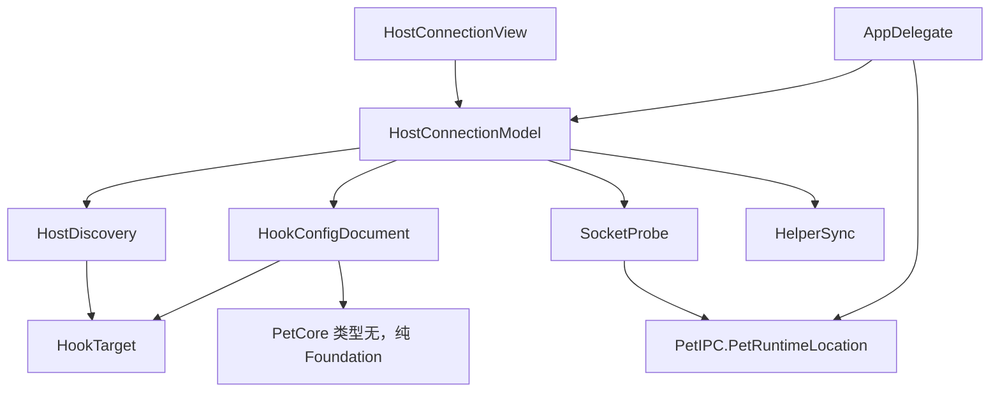

# Implementation Plan: 图形化宿主连接（Codex / Claude Code / DSH 探测）

**Delivery**: single PR（计划与实现同在 `feat/host-connection-ui`，基线 `main@66267a9`；提交与推送由主代理执行）

## Overview

把「接入宿主」从命令行搬到应用的设置窗口：探测已安装的宿主、多选要连接的宿主、一键写入或移除 hooks、三层测试连接状态，并保存选择。
本轮只做 Codex 与 Claude Code 的可写接入，以及 DSH 的只读探测与引导；DSH 的自动安装留给下一轮。

## Requirements

- 设置窗口新增「宿主连接」区域，逐个列出 Codex、Claude Code、本机发现的 DSH profile，并显示状态。
- 用户可多选宿主，点「保存」后：勾选的写入 hooks 配置并确保 helper 已安装；取消勾选的移除本项目 handler，其他 hook 与本项目无关的配置保持原样。
- 每次写入前备份原文件，写入使用同目录临时文件加 rename 的原子替换；任何一步失败都保留原文件并显示原因。
- 写入逻辑与 `scripts/install-hooks.py` 语义一致：识别本项目 command 的 handler、删除后折叠空组、重复执行不产生重复 handler、卸载时只移除本项目 handler。
- 提供测试：本机 socket 可达、配置与 helper 一致性、等待宿主真实事件三层，并分别显示结果。
- Codex 需要在 `/hooks` 或 Hooks 设置中审核启用的限制要在界面说明，不代写信任记录。
- DSH 行只读：显示已安装/未安装，以及「在 DSH 插件市场安装」或应用代跑 CLI 的说明；本轮不修改 DSH profile。
- 默认不预选任何宿主，状态来自磁盘探测。
- 非默认配置目录（`CODEX_HOME`、`CLAUDE_CONFIG_DIR`、`DSH_HOME`）的行为要明确：应用优先使用进程环境变量，缺失时用默认目录，界面显示实际使用的路径。

## Non-goals

- DSH 插件的自动安装/卸载（需要 pnpm 安装通道，下一轮单独做）。
- 代写 Codex 信任记录，或绕过 `/hooks` 审核。
- DSH 插件市场上架。
- 引入除 Codex、Claude Code 之外的宿主。
- 改动 bridge 协议、`contracts/bridge.schema.json` 或 `PetCore` 的依赖方向。

## Open Decisions

- **Critical**：DSH 安装是否本轮实现。决定：不实现，只探测与引导。理由是安装依赖 `dsh` CLI 与 pnpm store，需要按 profile 分别验证，超出本轮范围。
- **Important**：合并逻辑的单一实现。决定把语义搬到 Swift，`scripts/install-hooks.py` 保持现状作为无 GUI/CI 路径，两边由 `contracts/fixtures/host-hooks.json` 驱动一致性测试。不采用「应用调用 python3」，因为 macOS 未内置 python3。
- **Important**：GUI 写盘不保证键顺序与 Python 一致（Swift `JSONSerialization` 排序），一致性以解析后的语义相等为准，测试不比较字节。
- **Important**：GUI 不继承登录 shell 的环境变量。`CODEX_HOME` 等仅在应用进程自身有该变量时生效，界面显示解析结果，避免让用户误以为已支持任意自定义目录。

## Architecture Changes

当前接入只能靠脚本：`scripts/install-hooks.py` 完成合并、备份与 helper 复制，应用侧只做 `HelperSync`（仅当 helper 已存在且内容不同时替换，见 [HelperSync.swift](../../native/Sources/DSHNativePet/HelperSync.swift)）。设置窗口的「宿主连接」只有一行说明文字，没有任何操作入口（[SettingsView.swift:100](../../native/Sources/DSHNativePet/SettingsView.swift#L100) 附近）。用户必须打开终端。

本轮在应用 target 内新增一个 `Hosts` 子系统，负责「目标探测 → 配置合并 → 原子写入 → 状态与测试」；`PetCore` 不参与，依赖方向不变。`AppDelegate` 只增加三处接线：创建模型、把 settings 视图接上模型、把 hook 活动事件转给模型用于第三层测试。

### Target Directory Structure

```text
native/Sources/DSHNativePet/
├── AppDelegate.swift              # 接三处线：模型创建、视图注入、活动事件转发 [modify]
├── HelperSync.swift               # 增加 install()，sync() 改为复用 [modify]
├── SettingsView.swift             # 宿主连接区改为渲染 HostConnectionView [modify]
└── Hosts/                         # 宿主接入子系统 [new]
    ├── HookTarget.swift           # Codex/Claude 目标、事件表、command 拼接与 shlex 引号
    ├── HookConfigDocument.swift   # 读取/合并/备份/原子写，语义对齐 install-hooks.py
    ├── HostDiscovery.swift        # 配置目录解析、DSH profile 探测、helper 版本比较
    ├── SocketProbe.swift          # 连接本机 socket 验证监听可用
    ├── HostConnectionModel.swift  # ObservableObject：行状态、保存、三层测试编排
    └── HostConnectionView.swift   # SwiftUI：行、勾选、状态、测试按钮、保存
native/Tests/PetAppTests/
├── HookConfigDocumentTests.swift  # 合并/幂等/卸载/损坏配置/原子写/备份 [new]
├── HostDiscoveryTests.swift       # 目录解析、DSH 探测、helper 状态 [new]
└── HostConnectionModelTests.swift # 保存流程、三层测试状态机、超时 [new]
contracts/fixtures/
└── host-hooks.json                # 事件表 + 合并用例，Python 与 Swift 共用 [new]
scripts/tests/
└── test_install_hooks.py          # 增加对共享 fixtures 的校验 [modify]
docs/
├── host-hooks.md                  # 图形化入口为主，CLI 为备选 [modify]
└── acceptance.md                  # 本轮验收项与未覆盖项 [modify]
```

### File Change Map

| Current path | Target path | Operation | Responsibility and affected references |
| --- | --- | --- | --- |
| 无 | `native/Sources/DSHNativePet/Hosts/HookTarget.swift` | add | 定义 `HookTarget`（codex、claudeCode）与事件表，生成与 Python 完全一致的 command 字符串 |
| 无 | `native/Sources/DSHNativePet/Hosts/HookConfigDocument.swift` | add | `merge(config:command:events:remove:)`、`load`、`save`（备份 + 原子写） |
| 无 | `native/Sources/DSHNativePet/Hosts/HostDiscovery.swift` | add | 解析 `hooks.json` / `settings.json` 路径、枚举 `~/.dsh/profiles/*`、比较 helper |
| 无 | `native/Sources/DSHNativePet/Hosts/SocketProbe.swift` | add | 连接 `PetRuntimeLocation.socketPath` 后立即关闭，返回成功/失败原因 |
| 无 | `native/Sources/DSHNativePet/Hosts/HostConnectionModel.swift` | add | 行状态、选择集、保存、三层测试 |
| 无 | `native/Sources/DSHNativePet/Hosts/HostConnectionView.swift` | add | 设置页区块 |
| `native/Sources/DSHNativePet/HelperSync.swift` | 同路径 | modify | 新增 `install(bundled:installed:)`；`sync` 复用，保持「已存在才同步」的现有语义 |
| `native/Sources/DSHNativePet/SettingsView.swift` | 同路径 | modify | 「宿主连接」区替换为 `HostConnectionView`，保留 socket 路径与连接错误展示 |
| `native/Sources/DSHNativePet/AppDelegate.swift` | 同路径 | modify | 创建模型、注入视图、在 `startIPC` 的 `onUpdate` 中把 `.activity` 的 provider 转给模型 |
| `scripts/install-hooks.py` | 同路径 | modify（仅测试相关，行为不变） | 保持 CLI 语义；事件表改为从共享 fixtures 校验 |
| `scripts/tests/test_install_hooks.py` | 同路径 | modify | 增加共享 fixtures 的一致性用例 |
| `docs/host-hooks.md`、`docs/acceptance.md` | 同路径 | modify | 文档以图形化入口为主 |

### Module Responsibilities and Interfaces

| Module/path | Current responsibility | Proposed responsibility and public interface | State/resource owner |
| --- | --- | --- | --- |
| `HookTarget` | 无 | 目标枚举、事件表、`command(helperPath:)`、`shellQuote(_:)`（对齐 `shlex.quote`） | 无状态 |
| `HookConfigDocument` | Python 独占 | 纯函数合并 + 文件读写；`merge` 不触碰磁盘，`save` 负责备份与原子替换 | 目标配置文件 |
| `HostDiscovery` | 无 | `Target` 描述（名称、配置路径、helper 路径）、`dsnProfiles()`、`helperStatus()`；全部接受注入的 `home`/`environment` 便于测试 | 无（只读探测） |
| `SocketProbe` | 无 | `probe(path:timeout:) -> Result` | 无 |
| `HostConnectionModel` | 无 | `@Published` 行状态与测试结果；`reload()`、`save()`、`test(target:)`；`noteActivity(provider:)` 供 AppDelegate 回调 | 选择集、测试进行中状态 |
| `HelperSync` | 已存在才同步 | 增加 `install`，由 GUI 保存时调用 | 已安装 helper 文件 |

允许的依赖方向：`Hosts/*` 只依赖 Foundation、Darwin、PetCore、PetIPC；禁止 `Hosts/*` 依赖 `AppDelegate`。`PetCore` 仍不得依赖 AppKit（`scripts/check-boundaries.mjs` 会拦）。

### Architecture and Dependency Direction

箭头表示静态依赖；新增边只有应用 target 内部的组合关系，target 级依赖不变。



运行时数据流（保存）：用户勾选 → `HostConnectionModel.save()` → 对每个变化的目标：`HostDiscovery` 解析路径 → `HookConfigDocument.load` → `merge` → 备份 → 原子写；勾选且 helper 缺失或过期时调用 `HelperSync.install`。
运行时数据流（测试第三层）：用户点「测试」→ 模型记录期待 provider 与截止时间 → 宿主产生事件 → `UnixSocketServer` → `AppDelegate` 的 `onUpdate` → `model.noteActivity(provider:)` → 命中则通过，超时则失败。测试不会写入 `PetStore` 之外的状态，也不影响桌宠姿态。

## Ownership Map

| Path | Owner |
| --- | --- |
| `docs/plans/2026-10-24-host-connection-ui.md` | 主代理 |
| `native/Sources/DSHNativePet/Hosts/**`、`HelperSync.swift`、`SettingsView.swift`、`AppDelegate.swift` | Codex |
| `native/Tests/PetAppTests/**`（新增测试文件） | Codex |
| `contracts/fixtures/host-hooks.json`、`scripts/install-hooks.py`、`scripts/tests/test_install_hooks.py` | Codex |
| `docs/host-hooks.md`、`docs/acceptance.md`、`README.md` | 主代理 |

## Implementation Steps

### Phase 1: 共享语义与配置层

1. **共享 fixtures**（File: `contracts/fixtures/host-hooks.json`）
   - Action: 写入 `events`（codex/claude-code 事件表）与 `cases`（空配置安装、已有他人 handler、重复安装幂等、卸载、损坏形状 `hooks` 不是对象、group 缺 `hooks`）等用例，每个用例给出 `config`、`target`、`operation`、`expected`。
   - Why: 让 Python 与 Swift 共用同一份语义，避免两套实现漂移。
   - Expected result: 文件可被两侧测试读取。
   - Verify: `python3 -m json.tool contracts/fixtures/host-hooks.json >/dev/null`
   - Dependencies: None；Risk: Low
2. **Python 侧对齐**（File: `scripts/tests/test_install_hooks.py`）
   - Action: 增加用例循环，断言 `merge_hooks` 对 fixtures 的每个 case 产出 `expected`，且 `EVENTS` 与 fixtures 的 `events` 一致。`scripts/install-hooks.py` 的运行时行为不改。
   - Expected result: Python 测试数量增加且通过。
   - Verify: `python3 -m unittest discover -s scripts/tests -v`
   - Dependencies: Step 1；Risk: Low
3. **Swift 配置合并与写入**（Files: `Hosts/HookTarget.swift`、`Hosts/HookConfigDocument.swift`）
   - Action: 实现 `shellQuote`（完全对齐 `shlex.quote`：安全字符集 `A-Za-z0-9_@%+=:,./-`，否则单引号包裹并把 `'` 写成 `'\''`）、`command(helperPath:)`、`merge`、`load`、`save`。`save` 行为：读取现有文件（不存在视为 `{}`）→ 合并 → 若内容未变则不写 → 备份为 `<name>.dsh-native-pet-<UTC 时间戳>.bak`（0600）→ 同目录临时文件写入、`fsync`、`chmod` 后 `rename`。
   - Why: 这是 GUI 路径的唯一写入口。
   - Expected result: 与 fixtures 期望语义一致，重复保存不产生重复 handler。
   - Verify: `swift test --package-path native --disable-sandbox --filter HookConfigDocumentTests`
   - Dependencies: Step 1；Risk: Medium（写用户配置）
4. **配置层测试**（File: `native/Tests/PetAppTests/HookConfigDocumentTests.swift`）
   - Action: 覆盖 fixtures、idempotency、卸载只删本项目、损坏配置返回错误且不改文件、原子写保留旧文件（注入 rename 失败路径）、备份命名与权限、内容未变不写。
   - Risk: Low

### Phase 2: 探测与 helper

5. **Helper 安装能力**（File: `HelperSync.swift`）
   - Action: 新增 `install(bundled:installed:) throws -> Bool`（始终原子替换，创建父目录 0700）；`sync` 改为「存在则调用 install 比较后决定」，保持现有语义与测试不变。
   - Verify: `swift test --filter HelperSyncTests`
   - Risk: Low
6. **宿主探测**（File: `Hosts/HostDiscovery.swift`）
   - Action: 解析 Codex/Claude 配置路径（env → 默认）、读取 hooks 判断本项目是否已配置、比较已安装 helper 与包内 helper（缺失/过期/一致）、枚举 `DSH_HOME/profiles/*/package.json` 的 `dependencies['dsh-native-pet']` 与 `dsh.profile.bundles`。所有函数接受注入的 `home`、`environment`、`bundledHelper`。
   - Verify: `swift test --filter HostDiscoveryTests`（用临时目录构造 Codex/Claude/DSH 三种状态）
   - Risk: Low
7. **socket 探测**（File: `Hosts/SocketProbe.swift`）
   - Action: 以非阻塞 connect 连接 socket 路径后立即关闭，返回成功或 `errno` 描述；超时 1 秒。
   - Verify: 测试用临时 `UnixSocketServer` 启动后探测成功；路径不存在时失败。
   - Risk: Low

### Phase 3: 模型与界面

8. **连接模型**（File: `Hosts/HostConnectionModel.swift`）
   - Action: 持有 `[HostRow]`（target、已安装、选中、状态文案、测试结果）；`reload()` 每次从磁盘重读；`save()` 只处理发生变化的 target，返回成功列表与逐项错误；`test(target:)` 执行三层并在 UI 显示；`noteActivity(provider:)` 命中等待中的测试；等待超时用注入的 `now`/调度器便于测试。
   - Verify: `swift test --filter HostConnectionModelTests`
   - Risk: Medium（状态机）
9. **设置页区块**（File: `Hosts/HostConnectionView.swift` + `SettingsView.swift`）
   - Action: 列表行（勾选、名称、状态、[测试]、[打开配置文件所在目录]）；底部 [测试全部] [保存]；DSH 行只读并给出安装说明；显示实际使用的配置路径与 helper 状态；错误用行内红字。
   - Action 补充: `SettingsView` 只负责把 `HostConnectionModel` 传下去，原有「通知」「会话状态」区不变。
   - Verify: 构建后手动打开设置窗口，检查 3 种状态渲染
   - Risk: Medium（SwiftUI 布局）
10. **接线**（File: `AppDelegate.swift`）
    - Action: 创建 `hostConnections`；`showSettings` 传入；`startIPC` 的 `onUpdate` 中对 `.message(.activity(event))` 调用 `hostConnections.noteActivity(provider: event.provider)`。
    - Verify: 手动跑 `scripts/test-hook-app.py` 后，测试第三层能显示通过
    - Risk: Low

### Phase 4: 文档与验收

11. **文档**（Files: `docs/host-hooks.md`、`docs/acceptance.md`、`README.md`）
    - Action: 以图形化流程为主叙述，脚本作为无 GUI/CI 备选；写明写盘前备份、Codex 仍需要审核、非默认配置目录的限制、DSH 本轮只探测。
    - Risk: Low
12. **手动验收**
    - Action: 在临时 `HOME` 下用测试注入跑安装/卸载；再对真实 `~/.claude/settings.json`（先备份）做一次安装 → 状态变为已配置 → 卸载 → 恢复。
    - Risk: Medium（触碰真实配置，必须留备份）

## Testing Strategy

- Unit tests: `HookConfigDocumentTests`、`HostDiscoveryTests`、`HostConnectionModelTests`、`HelperSyncTests`、`scripts/tests/test_install_hooks.py`。
- Integration: `swift test` 全量、`npm --prefix bridge test`、`node scripts/check-boundaries.mjs`、`node scripts/check-contracts.mjs`。
- E2E: 打包后 `scripts/test-hook-app.py` 验证 hook 链路仍正常；界面三层测试人工确认。

## Final Verification

- `swift test --package-path native --disable-sandbox`
- `npm --prefix bridge run typecheck && npm --prefix bridge test`
- `python3 -m unittest discover -s scripts/tests -v`
- `node scripts/check-boundaries.mjs && node scripts/check-contracts.mjs`
- `bash scripts/package-app.sh && bash scripts/smoke-package.sh`
- `DSH_NATIVE_PET_APP=... npm --prefix bridge run test:native`
- 人工：临时 HOME 下安装/卸载；真实 Claude 配置安装后状态正确、卸载后恢复

## Risks & Mitigations

- **Risk**：GUI 写坏用户 hooks 配置，影响其他工具。
  - Mitigation：写入前备份、原子替换、失败保留原文件、损坏配置直接报错不改写、与 Python 版语义由 fixtures 对齐。
- **Risk**：`shlex.quote` 与 Swift 引号实现不一致，导致脚本装的 handler 无法被 GUI 识别，出现重复 handler。
  - Mitigation：默认安装路径含空格，fixtures 显式包含含空格与含单引号的路径用例。
- **Risk**：与在办 PR 冲突。PR #2 已合入 `main@66267a9`，本分支从其切出；`SettingsView.swift`、`AppDelegate.swift` 是热点文件，实现期间避免同时改这两文件的其它分支。
- **Risk**：DSH profile 结构变化导致探测误判。
  - Mitigation：只读探测，任何解析失败都降级为「未检测到」并展示原始路径。

## Remaining Risks

- Codex 的信任审核状态无法从应用侧可靠读取，界面只能提示「待启用」。
- 非默认 `CODEX_HOME`/`CLAUDE_CONFIG_DIR` 只有在应用进程本身带该环境变量时才被支持。
- DSH 自动安装未实现，DSH 用户仍需命令行或插件市场。

## Success Criteria

- [ ] 设置窗口可以列出 Codex、Claude Code 与本机 DSH profile 的状态，且默认无预选。
- [ ] 勾选保存后配置文件出现本项目 handler，重复保存不重复；取消勾选后只移除本项目 handler，其余配置逐字节等价（语义比较）。
- [ ] 保存过程生成备份，任何失败保留原文件并在界面显示原因。
- [ ] 三层测试能分别给出结果，第三层能在真实宿主事件到达时转为通过、超时给出失败。
- [ ] `scripts/install-hooks.py` 行为不变，Python 与 Swift 通过共享 fixtures 对齐。
- [ ] 全部 Final Verification 命令通过。
