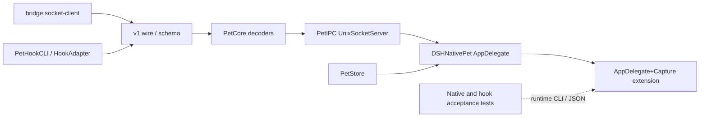

# Implementation Plan: 状态正确性与运行时收缩

**Delivery**: single PR。实现在独立 worktree 的 `fix/runtime-simplification` 分支进行，基于 `feat/native-desktop-pet`，完成后合回该分支；计划随实现一起提交。提交或推送需另行确认。

## Overview

在不增加新客户端、不做大规模模块重构的前提下，修正 hook 回合与终态生命周期，放宽私有 IPC 的可选字段兼容性，移除 DSH 等待通知的二次延迟和提醒截断，并收缩正式 App 中的验收代码。保留运行目录、socket、非阻塞 I/O、背压、数据最小化和关键防御上限；净代码量减少是预期而不是以牺牲正确性换取的验收指标。

本轮不处理系统通知降噪和点击通知响应，它们是下一轮的首要任务；本 PR 不代表通知体验问题已解决。

## Requirements

- Stop 后同回合的合法续跑能够恢复工作状态；两次 Stop 之间观察到更新的活动时，最终 Stop 再次提醒；没有中间活动的重复 Stop 只更新状态、不重复提醒。旧时间戳事实不能复活终态。
- 未见过的其他回合不能通过普通 tool、waiting 或 terminal 事件覆盖当前回合；只有 `turnStarted` 能切换已有会话的回合。当前 turnID 为空（仅收到 SessionStart）时，任意带 turnId 的事件可建立回合。
- 同回合终态事实（Stop、StopFailure、Interrupt）不受 `phaseOccurredAt` 时间倒挂影响，始终被接受；只有 Stop 形成的结束可被更新的同回合活动恢复，失败和中断保持终态直到新回合。
- 已结束回合不再因 15 分钟无新事件而显示“状态待确认”，终态历史默认保留 15 分钟后退出可见列表；非终态 stale 规则保持不变。
- DSH 快照只由 bridge 执行一次 300 ms 审批去抖，Swift 收到非基线 waiting 快照后立即生成一次等待通知；桌宠姿态仍保持当前即时呈现行为。
- 单批超过 256 条合法提醒时不再静默丢弃最早提醒。
- v1 消息允许缺省 `v` 或显式 `v: 1`，同版本未知可选字段被忽略；必需字段、类型、枚举、范围、消息大小及身份校验继续严格。
- 未知协议大版本被拒绝，并以独立的“协议不兼容”状态显示在菜单和设置中；它不进入 `connectionError`，不覆盖桌宠文字，其他来源照常呈现；不引入版本协商。
- v1 producer 暂不强制新增线上字段，避免新 helper/plugin 被旧 App 的精确字段集合拒绝。
- IPC 启动失败后不留下无单实例锁的桌宠实例；重复安装 helper 使用原子替换。
- 删除 UI 对 Core 中文文案的字符串替换，改为最小结构化 feedback；不拆 `PetStore` 为三个 module。
- capture/demo 代码与 `AppDelegate` 主流程分离，验收断言由外部测试执行，证据 JSON 仅保留实际消费字段。
- 文档保留当前支持与验收事实，移除代理工作过程和重复执行叙事，不删除仍可复现的一次性验收工具。

## Non-goals

- 不实现客户端选择、安装引导或“测试连接”UI。
- 不调整系统通知频率、声音、点击跳转或宿主前台识别策略。
- 不重写 `PetStore` 为 `SnapshotSources`、`HookSessions`、`Presenter` 三个 module。
- 不引入通用 LaunchOptions 框架、插件化客户端框架、协议版本协商或多版本 adapter。
- 不统一删除 event ID、工具、退休回合、会话数、输入字节等防御上限。
- 不处理点击穿透、热插拔位置、减少动态效果、气泡和角色视觉调整。
- 不调整空状态文案：终态会话全部退出列表后，hook-only 用户仍会看到现有的“未连接宿主”/“暂无宿主状态”，这是现状行为。
- 不删除 alpha 解码检查、录制通知 adapter、真实 release 验收入口或现有测试。
- 不批量移动 `scripts/`、重写历史计划或追求所有文档的归档重组。

## Open Decisions

- **Critical**: 无阻塞决策。v1 采用“缺省即 1、producer 可继续省略”的兼容规则，避免本轮制造新 producer → 旧 App 的回归。
- **Important**: 终态可见保留期采用现有 900 秒，不新增第三套 TTL；900 秒后从 presentation 和 `connectedSources` 排除，内存中的去重状态仍按现有 24 小时清理。
- **Important**: hook 没有可信的宿主事件全序。同回合 Stop 后按 helper 接收时间接受后续活动，可能把极晚到达的旧活动误认为续跑；本轮不解析不透明 turn ID，也不伪造宿主序号。若真实宿主后续提供全序，再升级协议。
- **Important（已决定）**: 终态事实不做 `phaseOccurredAt` 检查。真实顺序中终态总在回合末尾，倒挂只来自 helper 调度抖动；拒收终态会让会话卡在执行中、丢失结束提醒且无法恢复，接受较旧终态的最坏结果是一次提前提醒，并可被 Stop 续跑规则恢复。
- **Important（已决定）**: 已有会话的新回合若 `UserPromptSubmit` 投递失败，该回合后续事件（含 Stop）全部丢弃，用户收不到该回合结束提醒。接受此代价以换取旧回合隔离，并用测试固定。
- **Important（已决定）**: 没有工具调用的 Stop 续跑在 hook 层不可观测，两次 Stop 之间无事件时只提醒第一次。
- **Important**: capture 仍编译进 release，因为现有原生 E2E 面向 release 包。本轮只隔离和缩减，不新增 acceptance 构建配置。

## Architecture Changes

当前协议在 TS、Swift、嵌套 session/result 和 schema 多处执行精确字段集合检查，导致可选字段无法向后兼容；`UnixSocketServer` 又丢弃解码错误，使版本问题不可见。`PetStore` 将 terminal 当作不可恢复门闩，并让所有事件切换回合；快照等待通知还重复计时。`AppDelegate` 同时承载正常启动、UI、通知、截图和证据断言。

本次不增加 module 或反转依赖。协议兼容性由现有 wire decoder 负责；回合语义仍由 `PetStore` 负责；UI 排版由 `AppDelegate` 根据结构化 feedback 负责；capture 通过同 target 的 `AppDelegate` extension 隔离，外部 E2E 负责验收断言。

### Target Directory Structure

```text
bridge/
├── src/
│   ├── protocol.ts                 # 修改：宽松可选字段、v1 检查、移除 producer 自校验
│   └── socket-client.ts            # 保持 v1 线上格式与现有背压/重连
└── tests/
    ├── contract.test.ts            # 修改：共享 fixture 新语义
    ├── socket-client.test.ts       # 保持并补充 v1 兼容测试
    └── native-app.e2e.ts           # 修改：外迁 capture 断言、精简证据类型

contracts/
├── bridge.schema.json              # 修改：可选 v、允许未知可选字段
└── fixtures/
    ├── snapshots.json              # 修改：legacy/显式 v1/未知字段有效样例
    ├── activity.json               # 修改：activity 兼容样例
    └── invalid-messages.json       # 修改：未知大版本及非法必需字段

native/Sources/
├── PetCore/
│   ├── BridgeMessage.swift          # 修改：公共版本检查与 envelope 兼容
│   ├── PetState.swift              # 修改：嵌套解码放宽、结构化 feedback
│   └── PetStore.swift              # 修改：状态语义、等待通知、提醒队列
├── PetHooks/
│   └── HookAdapter.swift           # 保持 v1 数据最小化与现有八字段线上编码
├── PetIPC/
│   └── UnixSocketServer.swift       # 修改：上报不支持的版本
└── DSHNativePet/
    ├── AppDelegate.swift            # 修改：正常启动、IPC 失败退出、UI 格式化
    ├── AppDelegate+Capture.swift    # 新增：同 target capture extension
    ├── PetEventDispatcher.swift     # 修改：保持事件顺序，新增 .incompatible 事件
    ├── SettingsView.swift           # 修改：PetStatusModel.protocolWarning 及显示
    ├── StatusMenu.swift             # 修改：显示协议不兼容提示
    └── PetVideoPlayback.swift       # 保持真实解码帧及 alpha 证据

native/Tests/
├── PetCoreTests/                   # 修改：状态机、协议和提醒回归
├── PetIPCTests/                    # 修改：真实 socket 未知版本错误
├── PetHooksTests/                  # 保持 helper 数据最小化与兼容覆盖
└── PetAppTests/                    # 修改：结构化排版、设置行和 capture 资源回归

scripts/
├── install-hooks.py                # 修改：临时文件 + os.replace 原子升级
├── test-hook-app.py                # 保持现有 CLI 与所需证据字段
├── test-real-host-hooks.py         # 保持真实宿主验收
└── tests/test_install_hooks.py     # 修改：原子替换失败保留旧 helper

docs/
├── architecture.md                 # 修改：v1 兼容、状态与等待通知语义
├── development.md                  # 修改：capture 职责和验证入口（如有变化）
├── acceptance.md                   # 修改：当前已验证/未验证事实，移除过程叙事
└── plans/
    └── 2026-10-24-runtime-simplification.md  # 本计划
```

### File Change Map

| Current path | Target path | Operation | Responsibility and affected references |
| --- | --- | --- | --- |
| `native/Sources/PetCore/PetStore.swift` | 同路径 | Modify | 修 turn/terminal/stale；snapshot waiting 立即通知；移除 notices 截断；输出结构化 feedback |
| `native/Sources/PetCore/PetState.swift` | 同路径 | Modify | 放宽 session/result 未知键；新增 `PresentedFeedback` 和 `PetPresentation.feedback` |
| `native/Sources/DSHNativePet/AppDelegate.swift` | 同路径 | Split/Modify | 保留主流程；删除 capture 实现和字符串替换；IPC 非 `alreadyRunning` 启动失败走统一失败退出 |
| 新文件 | `native/Sources/DSHNativePet/AppDelegate+Capture.swift` | Add by extraction | 承接 capture 方法和证据；SwiftPM 自动编译，无需修改 `Package.swift` |
| `bridge/tests/native-app.e2e.ts` | 同路径 | Modify | 断言三帧 `sizePreference` 一致、首尾 `frame` 一致及现有脚底/透明像素条件 |
| `bridge/src/protocol.ts` | 同路径 | Modify | 必需键子集校验、v1 检查；`encodeMessage` 不再调用 `decodeMessage` |
| `native/Sources/PetCore/BridgeMessage.swift` | 同路径 | Modify | 公共版本 envelope、未知字段兼容、`unsupportedVersion` 错误 |
| `native/Sources/PetIPC/UnixSocketServer.swift` | 同路径 | Modify | 新增 `onIncompatible` 回调；换行帧和 EOF 最终帧的未知版本经该回调上报后 finalize |
| `native/Sources/DSHNativePet/PetEventDispatcher.swift`、`SettingsView.swift`、`StatusMenu.swift` | 同路径 | Modify | `.incompatible` 事件；`PetStatusModel.protocolWarning` 与菜单/设置显示，不覆盖桌宠文字 |
| `contracts/*`、`bridge/tests/contract.test.ts`、Core/Hook 测试 | 同路径 | Modify | 同步兼容 fixture 与解码断言，移除 producer 必须拒绝 invalid fixture 的旧假设 |
| `scripts/install-hooks.py` | 同路径 | Modify | helper 同目录临时复制、权限设置、`os.replace`；配置合并流程不变 |
| `scripts/tests/test_install_hooks.py` | 同路径 | Modify | 用真实临时 HOME 验证升级及失败时旧 helper 不变 |
| `docs/architecture.md`、`docs/acceptance.md`、`CONTEXT.md` | 同路径（按需） | Modify | 只更新当前权威语义；不保留已失效的严格八字段或 terminal 描述 |
| `docs/plans/2026-10-24-runtime-simplification.md` | 同路径 | Add | 记录实施边界与验证 |

### Module Responsibilities and Interfaces

| Module/path | Current responsibility | Proposed responsibility and public interface | State/resource owner |
| --- | --- | --- | --- |
| `bridge/protocol.ts` | 编解码及 producer 自校验 | decoder 校验 v1 必需字段并忽略未知可选字段；encoder 仅序列化和限制字节数 | 不持有状态 |
| `BridgeMessage` | 精确字段集合解码 | 缺省/显式 v1；不支持版本抛出可识别错误；保留全部数据校验 | 不持有连接状态 |
| `UnixSocketServer` | socket 生命周期与消息消费 | `start` 增加带默认值的 `onIncompatible` 回调；不支持版本经该回调上报后关闭该 client，`onError` 语义不变 | 持有 listener、client、锁和 timer |
| `PetStore` | 快照、hook、提醒和呈现 | 保持公开 apply/drain/presentation；局部修状态规则并暴露结构化 feedback | 持有内存会话和待分发提醒 |
| `AppDelegate` | 启动、UI、capture、通知 | 正常生命周期和 UI 格式化；capture 仅通过同对象 extension 使用内部状态 | 持有 panel、server、preferences |
| `AppDelegate+Capture` | 当前混在 AppDelegate | capture 执行与最小证据输出，不再断言换肤验收条件 | 不新增独立资源所有者 |
| `install-hooks.py` | 安装 helper 和合并配置 | 配置流程不变，helper 原子升级 | 调用进程内临时文件 |

### Architecture and Dependency Direction



实线箭头表示静态协议或模块依赖方向；虚线表示测试进程通过 CLI、socket 和证据文件进行运行时调用。没有新增 module 或反向依赖；`PetCore` 仍不依赖 AppKit，`PetIPC` 仍只依赖 Core/Darwin/Dispatch，capture 仍属于 App target。`check-boundaries.mjs` 与 SwiftPM target 编译继续检查这些边界。

运行时路径保持为 producer → socket → decoder → dispatcher → `PetStore` → `AppDelegate`；未知版本在 decoder 处失败，IPC 经 `onIncompatible` 上报并只关闭对应 client，dispatcher 写入 `PetStatusModel.protocolWarning`，不经过 `PetStore`，也不影响 presentation。正常停止、第二实例退出和启动失败都必须汇入 `shutdown()`/进程终止，确保 server、timer、视频和锁只清理一次；`stop()` 与 `shutdown()` 的幂等测试继续保留。

## Ownership Map

| Path | Owner |
| --- | --- |
| `bridge/src/**`、`bridge/tests/**` | current agent |
| `contracts/**` | current agent |
| `native/Sources/**`、`native/Tests/**` | current agent |
| `scripts/install-hooks.py`、`scripts/tests/**` | current agent |
| `docs/**`、`CONTEXT.md` | current agent |

共享 schema 与 fixtures 由同一 owner 修改，避免 TS/Swift 契约分别漂移。

## Implementation Steps

### Phase 1: 锁定并修复状态语义

1. **补充失败回归序列** (Files: `native/Tests/PetCoreTests/ActivityStoreTests.swift`, `PetStoreTests.swift`)
   - Action: 覆盖以下序列：
     - Stop → 更新的 toolStarted/toolFinished → Stop：恢复 working，第二个 Stop 再次提醒；
     - Stop → Stop（中间无事件）：只提醒一次（改写 `firstStopNotifiesOnceAndDoesNotClaimSuccess` 使其表达这一规则）；
     - Stop 后时间更早的 tool 事件不复活；StopFailure/Interrupt 后同回合活动不复活；
     - 当前 t2 时，未见过的 t0 的 tool/waiting/turnEnded/failed 均不改变 t2 状态、不产生提醒；
     - 已有会话的 t2 缺少 turnStarted 时，t2 的 tool 和 Stop 被丢弃（固定已决定的代价）；
     - 只有 SessionStart 的会话，首个带 turnId 的事件可建立回合；
     - 终态 timestamp 早于 waiting 时仍被接受；
     - terminal 899 秒仍显示、901 秒不 stale 且退出列表和 connectedSources；非终态 901 秒仍 stale；
     - 300 条 notices 不截断；DSH 非基线 waiting 快照立即产生提醒、连续 waiting 去重、离开后再次 waiting 可再提醒、基线 waiting 静默。
   - Why: 当前测试把“Stop 后任何事件都不能续跑”固定为正确行为，需先改为精确的新旧事实语义。
   - Expected result: 新测试在现实现上出现预期失败，现有首帧静默、重复事件和关闭会话测试仍通过。
   - Verify: `swift test --package-path native --filter ActivityStoreTests` 及 `--filter PetStoreTests`。
   - Dependencies: None。
   - Risk: Medium（不能简单删除 terminal guard）。

2. **局部修正 turn 与 terminal 规则** (File: `native/Sources/PetCore/PetStore.swift`)
   - Action:
     - 已有 turnID 的会话只允许 `.turnStarted` 切换到不同 turn；turnID 为空时任意带 turnId 事件可建立回合；其他陌生 turnId 事件直接丢弃（不刷新 `lastReceivedAt`）。
     - 非终态事件继续检查 `phaseOccurredAt`；终态事件不检查，接受时把 `phaseOccurredAt` 更新为 `max(当前, event.occurredAt)`。
     - 区分“Stop 结束”（可恢复）和“失败/中断”（不可恢复）：同 turn 中时间不早于 Stop 的 running/tool/waiting 事件清除 Stop 结束、result 和对应 feedback，恢复执行，并记录“自上次 Stop 以来有活动”。
     - 后续 Stop：有中间活动则再次 recordNotice/showFeedback；无中间活动只更新状态。
   - Why: 同时解决续跑被吞和旧事实污染，不引入新协议或 module。
   - Expected result: Stop 后新 tool 可恢复，最终 Stop 可再次提醒；旧 tool 和陌生回合不影响当前状态；失败/中断不被复活。
   - Verify: Phase 1 测试及完整 `swift test --package-path native`。
   - Dependencies: Step 1。
   - Risk: High（事件接收时间并非宿主全序，需保留该限制说明）。

3. **区分非终态 stale 与终态历史保留** (File: `native/Sources/PetCore/PetStore.swift`)
   - Action: stale 仅用于非 terminal；terminal 超过 900 秒不进入 presentation 和 connectedSources；现有 24 小时去重清理保持不变。
   - Why: 避免正常结束被误报为不确定，同时不让历史会话永久占据列表。
   - Expected result: 899 秒仍显示终态，901 秒不再显示“状态待确认”且历史行消失；非终态 901 秒仍 stale。
   - Verify: Core 测试和 Settings row 测试。
   - Dependencies: Step 2。
   - Risk: Low。

4. **移除 DSH 二次等待与 notices 截断** (File: `native/Sources/PetCore/PetStore.swift`)
   - Action: 用连续 waiting episode 集合替代 `snapshotWaiting` 时间字典；非基线首次 waiting 立即 recordNotice，连续 waiting 去重，离开后可再次提醒；删除 notices 256 截断和 drain 中 snapshot 定时循环。
   - Why: bridge 已按 `nextApprovalDeadline` 完成 300 ms 去抖；当前 Swift 只二次延迟通知，姿态原本就是即时的。
   - Expected result: DSH waiting 通知总延迟恢复为一次 300 ms；初始/重连基线静默；300 条结果完整保留顺序。
   - Verify: `PetStoreTests`、bridge approval 单测和 Host E2E。
   - Dependencies: Step 1，独立于 Step 2/3。
   - Risk: Medium（不能把 hook 的 Swift 300 ms 一并删除）。

### Phase 2: 协议兼容与错误可见性

5. **建立 v1 兼容 fixture** (Files: `contracts/bridge.schema.json`, `contracts/fixtures/*.json`)
   - Action: 三种 envelope 增加可选 `v: 1`；未知字段样例从 invalid 移至 valid；加入 v2、非法 v、缺必需字段和错误类型 invalid 样例；保留无 v 的现有 valid 样例。
   - Why: 同时锁定 legacy 和显式 v1，未知大版本仍必须失败。
   - Expected result: schema 接受 v1 未知可选字段，拒绝未知版本及破坏必需契约的数据。
   - Verify: `node scripts/check-contracts.mjs`。
   - Dependencies: None。
   - Risk: Medium（同一 invalid fixture 不可同时留在拒绝集合）。

6. **放宽 TS/Swift decoder 并移除 producer 自校验** (Files: `bridge/src/protocol.ts`, `native/Sources/PetCore/BridgeMessage.swift`, `PetState.swift`)
   - Action: 必需键改为子集检查；版本缺省为 1，显式 null/字符串/v2 拒绝；保留枚举、safe integer、ID、大小和 nullable 必需键；删除 `encodeMessage` 内 decode 调用。
   - Why: 同版本可选扩展不再导致断连，安全和数据完整性仍由 receiver 校验。
   - Expected result: 无 v 与显式 v1 均可解码；未知字段不进入领域模型、不被日志记录；v2 返回明确错误。
   - Verify: `npm --prefix bridge run typecheck && npm --prefix bridge test`、`swift test --package-path native --filter ContractTests`。
   - Dependencies: Step 5。
   - Risk: Medium（类型校验不能被“宽松读取”一并删除）。

7. **保持 v1 producer 线上兼容并上报未知版本** (Files: `bridge/src/socket-client.ts`, `native/Sources/PetHooks/HookAdapter.swift`, `native/Sources/PetIPC/UnixSocketServer.swift`)
   - Action:
     - v1 producer 继续输出当前字段集合；不为追赶格式强制增加 `v`。
     - `UnixSocketServer.start` 增加独立回调 `onIncompatible: (String) -> Void`（默认空实现），在换行帧及 EOF 帧捕获 `unsupportedVersion` 时调用，再 finalize；其他坏帧仍按原策略静默丢弃。不复用 `onError`。
     - `PetEventDispatcher` 增加 `.incompatible(String)` 事件；`PetStatusModel` 增加 `protocolWarning: String?`，由 AppDelegate 写入，StatusMenu 与 SettingsView 显示，例如“有组件协议版本不兼容，请更新 DSH 插件或重新安装宿主接入”。
     - `protocolWarning` 不参与 `AppDelegate.refresh()` 中“连接异常，查看菜单栏”的文字覆盖；当前进程内保持到下次启动或用户打开设置后仍可见，不做自动清除。
   - Why: 新 App 可读旧 helper；新 helper 不会因显式 v1 被旧 App 拒绝；未来 v2 能被用户看见。现有 `connectionError` 只在 `server.start` 的一次性 `onReady` 中清除（`UnixSocketServer.swift:90`），且非空时会覆盖桌宠全部文字（`AppDelegate.swift:228`），复用它会让一条 v2 消息永久遮蔽其他正常来源。
   - Expected result: 真实 socket 收到 v2 后无 message、连接关闭、`onIncompatible` 被调用一次、`onError` 不被调用；其他来源的快照继续正常呈现，桌宠文字不变；legacy smoke 不受影响。
   - Verify: `swift test --package-path native --filter UnixSocketServerTests`、App 测试断言 protocolWarning 不改变 presentation 文字、`node scripts/smoke-ipc.mjs`。
   - Dependencies: Step 6。
   - Risk: Medium（需要新增独立 UI 状态，不能复用 connectionError）。

### Phase 3: 启动与安装可靠性

8. **IPC 启动失败统一退出** (File: `native/Sources/DSHNativePet/AppDelegate.swift`)
   - Action: 非 `alreadyRunning` 的 server.start 错误不再记录后继续，走现有 `fail`/shutdown 终止路径；保持第二实例不删除第一实例 socket。
   - Why: server.start 失败已释放 flock，继续运行会产生多个无 IPC 实例。
   - Expected result: runtime 权限或普通文件占 socket 时进程失败退出，不显示无主窗口；资源只清理一次。
   - Verify: IPC preparation 测试、打包后普通文件占用与双实例手工/脚本场景。
   - Dependencies: None。
   - Risk: Low。

9. **原子替换 helper** (Files: `scripts/install-hooks.py`, `scripts/tests/test_install_hooks.py`)
   - Action: 在 destination 同目录创建临时文件，复制、chmod 后 `os.replace`；失败清理临时文件并保留旧 helper。配置合并不增加 mtime/锁机制。
   - Why: 在 Apple Silicon 上原地覆盖已签名可执行文件会保留同一 inode，内核缓存的代码签名与新内容不一致，后续执行可能被 SIGKILL，导致所有宿主事件静默丢失；同时消除复制中断或并发执行读取到截断二进制的风险。`os.replace` 产生新 inode，可同时解决两者。
   - Expected result: 正常升级幂等；注入复制/替换失败时旧文件字节和权限保持不变。
   - Verify: `python3 -m unittest discover -s scripts/tests -v`。
   - Dependencies: None。
   - Risk: Low。

### Phase 4: 呈现与验收代码收缩

10. **用结构化 feedback 替换文案解析** (Files: `native/Sources/PetCore/PetState.swift`, `PetStore.swift`, `native/Sources/DSHNativePet/AppDelegate.swift`, `native/Tests/PetAppTests/PetNotificationTests.swift`)
    - Action: 增加包含 pose、无来源前缀 text、可选 sourceLabel 的 `PresentedFeedback`；保留现有 presentation.text；UI 按 pose/source/activeCount 排版，删除所有 replacingOccurrences。
    - Why: Core 不再通过中文字符串与 UI 隐式耦合，改动范围小于拆 Presenter module。
    - Expected result: 现有单行和并行两行文案保持一致，DSH 与 hook 来源格式不回归。
    - Verify: Swift UI/Core 测试和 capture 文本断言。
    - Dependencies: Step 2/3 可减少重复修改 PetStore。
    - Risk: Medium。

11. **纯抽取 capture 实现** (Files: `native/Sources/DSHNativePet/AppDelegate.swift` → `AppDelegate+Capture.swift`)
    - Action: 单独提交只移动 `capturePreview`、`captureSkinSwitch`、`writeCapture`；把跨文件所需 private 成员最小放宽为 target internal，不改 CLI、JSON、日志、时序或断言。
    - Why: 将纯移动与行为变化分开，便于审查和回归定位。
    - Expected result: 所有 capture 行为与证据逐字节保持原语义。
    - Verify: `swift test --package-path native`、打包后原生 E2E。
    - Dependencies: 无；若与 Step 10 同文件冲突，先完成 Step 10 再移动。
    - Risk: Medium（Swift extension 访问级别）。

12. **集中 automation 判断并缩减证据** (Files: `AppDelegate.swift`, `AppDelegate+Capture.swift`, `bridge/tests/native-app.e2e.ts`)
    - Action: 复用一个内部自动化判定，不建立新框架；缺值和互斥组合在副作用前报错；保留所有真实 CLI 消费者。外部测试增加 sizePreference 与首尾 frame 断言，再删除 App 内换肤断言。证据仅保留当前消费字段及迁移所需的 frame/sizePreference。
    - Why: 避免缺值回落正常 IPC/真实通知；验收由测试拥有，release 不再承担重复断言。
    - Expected result: 不借机增删无关 CLI；`--smoke-test`、demo、capture、notification-log 现有调用均工作；无消费者的 footPosition/sessions/notificationRequestCount 等字段删除。
    - Verify: `npm --prefix bridge run test:native`、`python3 scripts/test-hook-app.py --app 'dist/DSH Native Pet.app' --output dist/multi-host-acceptance/hook-app`、`bash scripts/smoke-package.sh`；`PetVideoPlayback.decodedFrame` 的图像、透明/不透明像素统计和 videoTime 不修改，因其仍被 `PetSkinTests` 和换肤 E2E 消费，另跑 `swift test --package-path native --filter PetSkinTests` 与 `swift scripts/validate-dsh-pet.swift`。
    - Dependencies: Step 11。
    - Risk: Medium（测试读取日志行和 PNG/JSON，不能只编译验证）。

### Phase 5: 文档同步与最终验收

13. **压缩当前文档** (Files: `docs/architecture.md`, `docs/acceptance.md`, `docs/development.md`, `CONTEXT.md`)
    - Action: 更新 v1、Stop 续跑、终态保留、单次 DSH 去抖；acceptance 仅保留当前已验证范围、环境限制和未验收项，移除主代理过程与重复修复叙事。历史细节留在 git 历史，不回写旧计划。
    - Why: 文档描述当前事实，而不是 agent 工作日志。
    - Expected result: 文档不再声称未知字段一律拒绝或所有长期无事件会话都 stale。
    - Verify: 文档链接及命令人工核对；若引用变更路径则全部可解析。
    - Dependencies: Steps 1–12。
    - Risk: Low。

14. **执行完整回归并记录未测项** (Files: `docs/acceptance.md`)
    - Action: 运行标准检查、release 打包、原生联合 E2E 和可用真实宿主测试；未实际运行的实机项目明确保留，不把单元测试写成视觉或系统通知证据。
    - Why: 本次跨协议、状态、安装器和 release capture，单一层测试不足以证明交付。
    - Expected result: 所有可运行检查通过，剩余风险有明确边界。
    - Verify: Final Verification 全部命令。
    - Dependencies: 所有实现步骤。
    - Risk: Medium（真实宿主和 GUI 依赖本机环境）。

## Testing Strategy

- Unit tests: Core 回合顺序、Stop 续跑、终态保留、DSH waiting episode、300 条 notices；TS/Swift/schema 三类兼容；结构化文案；安装失败保留旧 helper。
- Integration tests: 真实 Unix socket 的 legacy/v1/v2、断连隔离和单实例；DSH Host 审批只等待一次；release capture 的外部断言和 notification JSONL。
- E2E tests: 真实 DSH Host；Codex/Claude 原始 hook → helper → App；可用时运行真实宿主确定性模型；打包移动、资源和签名检查。
- 不做仅以 import/compile 代替行为的验证，不为追求测试数量新增重复场景。

## Final Verification

```sh
npm --prefix bridge ci
npm --prefix bridge run typecheck
npm --prefix bridge test
npm --prefix bridge run test:e2e
npm --prefix bridge run build
swift test --package-path native
swift build --package-path native --product PetIPCSmoke
python3 -m unittest discover -s scripts/tests -v
node scripts/check-boundaries.mjs
node scripts/check-contracts.mjs
swift scripts/validate-assets.swift
swift scripts/validate-dsh-pet.swift
node scripts/smoke-ipc.mjs
bash scripts/package-app.sh
bash scripts/smoke-package.sh
DSH_NATIVE_PET_APP="$PWD/dist/DSH Native Pet.app/Contents/MacOS/DSHNativePet" \
DSH_NATIVE_PET_CAPTURE_DIR="$PWD/dist/acceptance" \
npm --prefix bridge run test:native
python3 scripts/test-hook-app.py --app 'dist/DSH Native Pet.app' --output dist/multi-host-acceptance/hook-app
python3 scripts/test-real-host-hooks.py --app 'dist/DSH Native Pet.app' --output dist/multi-host-acceptance/real-hosts
```

若本机缺少真实宿主或 GUI 条件，必须明确标记相应命令未验证；不得用 smoke 结果替代。

在受沙箱限制的执行环境中，SwiftPM 编译 manifest 会因 `sandbox-exec: sandbox_apply: Operation not permitted` 失败，此时 `swift test`/`swift build` 需追加 `--disable-sandbox`；这不改变验证范围。

## Risks & Mitigations

- **Risk**: Stop 后的接收顺序不等于宿主真实顺序，旧活动仍可能误复活。
  - Mitigation: 只接受时间不小于 terminal 的同 turn 活动，文档明确限制；不比较 opaque ID，后续只有宿主提供全序才升级。
- **Risk**: 已有会话新回合的 `UserPromptSubmit` 投递失败时，该回合事件（含 Stop）全部丢弃，结束提醒丢失。
  - Mitigation: 接受为已决定代价并以测试固定；helper 500 ms 期限内本机 socket 投递失败罕见。
- **Risk**: 接受时间较旧的终态可能提前一次结束提醒。
  - Mitigation: Stop 结束可被更新活动恢复并再次提醒；失败/中断在真实宿主中只在回合末尾产生。
- **Risk**: 协议不兼容提示复用 connectionError 会遮蔽全部桌宠文字。
  - Mitigation: 独立 `protocolWarning` 字段，App 测试断言它不改变 presentation 文字。
- **Risk**: 宽松字段被误实施为宽松类型或记录未知内容。
  - Mitigation: 共享 invalid fixtures 保留类型/范围/必需字段；producer 白名单和隐私测试不变，未知字段不进入日志或领域模型。
- **Risk**: v1 显式版本导致新旧组件交叉升级失败。
  - Mitigation: 当前 producer 保持无 v 的 v1 线上格式；decoder 同时接受缺省和显式 v1。
- **Risk**: capture 抽文件改变访问级别或证据导致 E2E 失效。
  - Mitigation: 纯移动和字段缩减分开；先补外部断言，再删内部断言；运行 release 原生 E2E。
- **Risk**: 状态修复与结构化呈现同时修改 PetStore 造成回归难定位。
  - Mitigation: 状态语义先独立通过，再增加 feedback 字段；每阶段运行 Core/UI 测试。
- **Risk**: 文档压缩丢失当前支持边界。
  - Mitigation: 保留已验证和未验证事实，只删除过程叙事，不 retroactively 修改历史验收结论。

## Remaining Risks

- 旧 helper 仍只向 stderr 报告一般投递失败，本轮只保证 App 能看到未知大版本；完整安装诊断 UI 留待后续。
- capture 自动化仍在 release 二进制中，只是隔离和缩小；是否建立独立 acceptance 构建由后续真实维护成本决定。
- event/tool/retiredTurn/session 上限暂时保留，尚未以长期运行数据证明可进一步统一。
- 系统通知噪声、点击无响应、客户端自助接入和热插拔位置仍是独立产品问题，不在本次完成声明内。

## Success Criteria

- [ ] Stop 续跑、旧 turn/旧终态隔离和终态不 stale 的回归全部通过。
- [ ] DSH 等待通知只去抖一次，首帧静默和连续 waiting 去重保持；300 条提醒不丢失。
- [ ] legacy/v1 可选字段互通，未知大版本在菜单与设置可见且不遮蔽桌宠文字，所有安全与必需字段校验保留。
- [ ] IPC 启动失败不留下无锁实例，helper 原子升级失败不损坏旧版本。
- [ ] UI 不再解析 Core 中文文案，现有呈现结果保持。
- [ ] AppDelegate 与 capture 分离，证据只含消费字段，外部测试承接换肤断言，release E2E 通过。
- [ ] 未增加新 module/通用框架，未删除必要安全边界和有效测试。
- [ ] 标准构建、单测、集成、打包及本机可执行的 E2E 全部通过，未测项如实记录。

## Execution Evidence

实现由 Codex 在 worktree 中完成；Codex 沙箱禁止创建 socket 和写入 git 元数据，因此真实 socket、GUI 相关验收和最终回归由主会话在本机重跑，结果见 [验收记录](../acceptance.md)。
主会话审查时补充修正：Stop 结束后同回合收到 StopFailure 或 Interrupt 时，原实现会吞掉错误/中断提醒，已改为升级终态并提醒一次。
