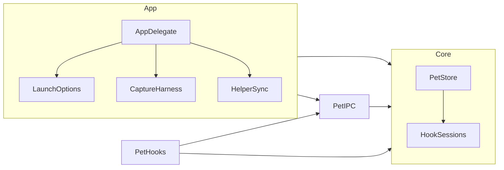

# Implementation Plan: 回合生命周期、提醒降噪与运行边界修复

**Delivery**: single PR（计划与实现同在 `feat/native-desktop-pet`；仅在用户要求时提交）

## Overview
先定义 hook 回合生命周期，再据此修正 Stop 续跑、陌生回合、已结束会话误判 stale 三个状态问题。
随后收紧提醒（去掉快照 waiting 的二次计时、到期主动刷新、按类型发声、短回合不发结束通知、点击可定位会话），修复 IPC 失败锁、helper 替换与拒绝原因不可见。
最后把截图证据逻辑与启动参数移出 AppDelegate，拆出 hook 会话状态类型，净代码量预期下降。

## Requirements
- Stop 后同回合出现更晚的活动事实（`turnStarted`/`running`/工具/waiting）时恢复活动；恢复后的 Stop 再提醒一次；两个 Stop 之间没有活动事实时只更新时间、不重复提醒；StopFailure/Interrupt 仍为终态。
- 陌生 turnId：当前回合活动时，只有 `turnStarted` 切换回合，其他事件只刷新 `lastReceivedAt`；当前回合不活动（ended/terminal/idle）时，任意事件都可建立新回合（覆盖 UserPromptSubmit 投递失败的情况）。已见旧回合仍由 `retiredTurns` 拒绝。
- 终态事件保持不做 `phaseOccurredAt` 检查：拒收终态会让会话卡在执行中且无法恢复，接受较旧终态的代价是可被后续活动纠正的一次提醒。
- 只有活动回合参与 stale 判断；非活动 hook 会话 900 s 无新事实后退出列表。
- 收到过任意 hook 事件后，空列表显示“准备就绪”，不再显示“未连接宿主”。
- DSH 快照的 waiting 由 bridge 去抖，Swift 收到非基线快照中新出现的 waiting 立即提醒。
- hook waiting 到期、反馈到期时主动刷新，不依赖 1 s 定时器。
- 系统通知：waiting、error 带声音，结束与中断静音；结束与中断在回合时长短于阈值（默认 3 s）时不发系统通知，桌宠反馈不变。
- 点击系统通知或在等待状态点击桌宠，打开设置并定位、高亮对应会话。
- 通知发送成功后清除旧错误；通知权限被拒时菜单和设置提供打开系统设置的入口。
- IPC 监听失败不释放实例锁，菜单提供重试；IPC 拒绝消息时在设置中显示原因，不进入桌宠气泡。
- 安装器原子替换 helper；应用启动时若已安装 helper 与包内版本不同，原子同步。
- 屏幕参数变化只约束位置不保存；遵守系统“减弱动态效果”。
- TS 解码器拒绝重复 sessionId，与 Swift 一致。
- 自动化参数统一解析，缺值立即报错；截图证据只保留测试读取的字段，应用内断言移回测试。
- 呈现文本只保留一种气泡格式，删除 AppDelegate 的字符串替换。

## Non-goals
- 新视觉效果、气泡常驻策略、首帧区分角标、表情和描边调整（单独验收）。
- 新验收入口、通用客户端插件系统、三层 module 重构。
- 协议版本协商与 `v` 字段（见 Open Decisions）。
- 安装器并发 mtime 检查、提醒溢出聚合。
- 透明区域 hitTest：实机确认存在问题后另行处理。
- 验收文档与旧计划压缩（后续单独整理）。

## Open Decisions
- **Important**：协议 `v` 字段改为“应用启动同步 helper + 拒绝原因可见”。当前没有待发布的线格式变更，加 `v` 只为预防；而旧 helper 滞留这个真实问题由同步直接修复。若后续变更线格式再引入版本号。
- **Important**：结束提醒的短回合阈值默认 3 s，保存在 `pet.noticeMinimumSeconds`，暂不在设置界面暴露；自动化脚本传 `-pet.noticeMinimumSeconds 0`。

## Architecture Changes
SwiftPM target 与依赖方向不变：`PetCore` 仅依赖 Foundation，`PetIPC → PetCore`，`PetHooks → PetCore, PetIPC`，应用 → `PetCore, PetIPC`。
变化发生在文件和类型层面：

- 当前 `PetStore`（319 行）同时承担 DSH 快照跟踪、hook 回合状态机、去重、提醒队列、反馈槽和聚合；hook 生命周期用 `terminal`/`closed` 两个布尔表达，无法表示“本轮结束但可续跑”（`PetStore.swift:143-145`）。
- 当前 `AppDelegate`（457 行）约 150 行是自动化参数、截图和证据 JSON，自动化判断散落三处（`AppDelegate.swift:12-14, 88, 414`），并含测试断言（`:336-341`）。
- 当前 `RuntimeDirectory.prepare()` 把实例锁和 socket 绑在一起，`start` 失败时一起释放（`UnixSocketServer.swift:91-93`）。

### Target Directory Structure

```text
native/Sources/
├── PetCore/
│   ├── PetState.swift            # 线格式与呈现类型；PetNotice 增加 turnDuration [modify]
│   ├── HookSessions.swift        # hook 回合生命周期、去重、过期、waiting 到期 [new，自 PetStore 拆出]
│   └── PetStore.swift            # DSH 快照、反馈槽、提醒队列、聚合与 nextDeadline [modify，缩小]
├── PetIPC/
│   ├── RuntimeDirectory.swift    # 实例锁与 socket 生命周期分离 [modify]
│   └── UnixSocketServer.swift    # 失败保锁、isRunning、onReject [modify]
└── DSHNativePet/
    ├── AppDelegate.swift         # 组合与刷新；到期调度、重试、聚焦会话 [modify，缩小]
    ├── LaunchOptions.swift       # 启动参数唯一解析入口 [new]
    ├── CaptureHarness.swift      # 截图与精简证据 JSON [new，自 AppDelegate 拆出]
    ├── HelperSync.swift          # 启动时原子同步已安装 pet-hook [new]
    ├── PetNotifications.swift    # 发声策略、短回合过滤、点击回调、错误清除 [modify]
    ├── SettingsView.swift        # 聚焦高亮、拒绝原因、权限入口 [modify]
    ├── StatusMenu.swift          # 重试连接、权限入口 [modify]
    └── PetPreferences.swift      # noticeMinimumSeconds 只读偏好 [modify]
scripts/install-hooks.py          # helper 原子替换 [modify]
bridge/src/protocol.ts            # 拒绝重复 sessionId [modify]
```

### File Change Map

| Current path | Target path | Operation | Responsibility and affected references |
| --- | --- | --- | --- |
| `PetCore/PetStore.swift` 中 `HookSession`、`apply(PetActivityEvent)`、`pruneHooks`、hook waiting 提醒 | `PetCore/HookSessions.swift` | split | hook 生命周期独立成值类型；`PetStore` 调用它并汇总输出；`ActivityStoreTests` 继续经 `PetStore` 测试 |
| `PetCore/PetStore.swift` | 同路径 | modify | 删除快照 waiting 二次计时；增加 `nextDeadline(after:)`；气泡文本单一格式 |
| `PetCore/PetState.swift` | 同路径 | modify | `PetNotice.turnDuration: TimeInterval?` |
| `DSHNativePet/AppDelegate.swift` 中参数解析 | `DSHNativePet/LaunchOptions.swift` | split | 缺值报错；`automated`、`persistsPreferences`、`showsAlerts` 单点定义 |
| `DSHNativePet/AppDelegate.swift` 中 capture 代码 | `DSHNativePet/CaptureHarness.swift` | split | 证据字段收缩到测试读取项加 `frame`；脚底与窗框断言移到 `native-app.e2e.ts` |
| `AppDelegate.presentationText` | 删除，sleeping 文本保留为私有小函数 | delete | `PetNotificationTests` 改为直接用 `presentation.text` |
| new | `DSHNativePet/HelperSync.swift` | add | 仅 `.app` 正常启动执行 |
| `PetIPC/RuntimeDirectory.swift`、`UnixSocketServer.swift` | 同路径 | modify | `UnixSocketServerTests` 新增保锁与重试用例 |
| `scripts/install-hooks.py` | 同路径 | modify | `scripts/tests/test_install_hooks.py` 新增原子替换用例 |
| `scripts/test-hook-app.py`、`scripts/test-real-host-hooks.py` | 同路径 | modify | 启动参数加 `-pet.noticeMinimumSeconds 0` |
| `bridge/src/protocol.ts` | 同路径 | modify | `bridge/tests/contract.test.ts` 新增用例；共享 fixtures 不变（schema 无法表达按字段唯一） |
| `docs/architecture.md`、`docs/host-hooks.md`、`CONTEXT.md` | 同路径 | modify | 生命周期、提醒语义、sourceId 按宿主类型区分的说明 |

### Module Responsibilities and Interfaces

| Module/path | Current responsibility | Proposed responsibility and public interface | State/resource owner |
| --- | --- | --- | --- |
| `HookSessions` | （在 PetStore 内） | `mutating apply(_:at:) -> HookOutput`、`drainWaiting(at:) -> [PetNotice]`、`presented(at:) -> [PresentedSession]`、`nextDeadline() -> Date?`、`activeSourceIDs` | hook 会话表、事件去重集合 |
| `PetStore` | 全部状态与聚合 | `apply(SourceSnapshot)`、`apply(PetActivityEvent)`、`disconnect`、`drainNotices`、`presentation`、`nextDeadline(after:)` | 快照来源、反馈槽、提醒队列 |
| `UnixSocketServer` | 监听、客户端、锁 | 新增 `isRunning`、`start(... onReject:)`；失败保留锁，`stop()` 无论监听是否建立都释放锁 | socket、实例锁 |
| `LaunchOptions` | （散落） | `static func parse(_ arguments: [String], environment:) throws -> LaunchOptions` | 无 |
| `CaptureHarness` | （在 AppDelegate 内） | `capturePreview()`、`captureSkinSwitch()`，依赖 AppDelegate 注入的只读访问 | 无 |

### Architecture and Dependency Direction

箭头表示静态依赖（import / 类型引用），target 级依赖不变：



运行时流程：IPC 串行队列解码消息 → 主队列 `PetStore.apply` → `AppDelegate.refresh()` 排空提醒、渲染、读取 `nextDeadline` 调度一次性刷新。
拒绝消息走 `onReject` → `PetStatusModel.lastRejection`，不写 `connectionError`。

## Turn Lifecycle

| 状态 | 进入 | 离开 | stale | 列表 |
| --- | --- | --- | --- | --- |
| active | `turnStarted`、活动事实、续跑 | Stop → ended；失败/中断 → terminal；`SessionEnd` → closed | 900 s 无新事实显示“状态待确认” | 显示；24 h 后清理 |
| ended | `Stop`（非后台任务） | 同回合更晚的 `turnStarted`/`running`/工具/waiting → active；更晚的 failed/interrupted → terminal | 否 | 900 s 无新事实后移除 |
| terminal | `StopFailure`、`Interrupt` | 新回合 | 否 | 900 s 无新事实后移除 |
| closed | `SessionEnd` | 无 | 否 | 立即移除 |

“更晚”指 `occurredAt >= endedAt` 的活动事实；ended 状态下再次收到 Stop 不提醒。
没有工具调用的续跑在两个 Stop 之间没有可观测事件，这类续跑只产生第一次提醒。
`retiredTurns` 与 `finishedTools` 保留：前者拒绝已见旧回合，后者处理工具结束先于开始。

## Ownership Map
| Path | Owner |
| --- | --- |
| `native/Sources/**`、`native/Tests/**` | Codex（执行），主代理验收 |
| `bridge/src/**`、`bridge/tests/**` | Codex（执行），主代理验收 |
| `scripts/**` | Codex（执行），主代理验收 |
| `docs/**`、`CONTEXT.md` | 主代理 |

## Implementation Steps

### Phase 1: 回合生命周期与 stale
1. **生命周期测试先行**（File: `native/Tests/PetCoreTests/ActivityStoreTests.swift`）
   - Action: 新增续跑（Stop → 更晚工具 → working → 再 Stop → 第二条 ended 提醒）、陌生终态不覆盖、陌生非终态仅在非活动时建回合、ended 900 s 后移除且不显示“状态待确认”；改写 `endedTurnCannotBeReactivated…` 为续跑语义。
   - Expected result: 新用例在旧实现下失败。
   - Verify: `swift test --package-path native --disable-sandbox --filter ActivityStoreTests`
   - Dependencies: None；Risk: Low
2. **实现生命周期**（File: `native/Sources/PetCore/PetStore.swift`）
   - Action: `terminal`/`closed` 布尔改为 `Lifecycle { active, ended(at), terminal, closed }`；按上表处理；stale 只判活动回合；`pruneHooks` 对非活动会话用 900 s。
   - Expected result: Phase 1 全部用例通过，原有用例除被改写项外不变。
   - Dependencies: Step 1；Risk: Medium（状态机回归）

### Phase 2: 提醒
3. **快照 waiting 立即提醒与到期刷新**（Files: `PetStore.swift`, `AppDelegate.swift`）
   - Action: `snapshotWaiting` 改为 `Set<SessionKey>`，非基线快照新出现 waiting 立即记录提醒，删除 `snapshotWaitingNotified` 和 drain 中的快照循环；新增 `nextDeadline(after:)`（hook waiting +0.3 s、反馈到期）；AppDelegate 每次刷新后调度一次性 `Timer`。
   - Verify: `PetStoreTests` 新增快照 waiting 在同一时刻 drain 即得提醒；基线 waiting 不提醒。
   - Risk: Low
4. **发声与短回合过滤**（Files: `PetState.swift`, `PetStore.swift`, `PetNotifications.swift`, `PetPreferences.swift`, `AppDelegate.swift`, 两个 Python 脚本）
   - Action: `PetNotice.turnDuration`（hook 取 `occurredAt - turnStartedAt`；DSH 取会话进入活动的接收时刻至结果时刻）；`PetNotificationDispatcher.refresh(store:enabled:minimumDuration:at:)`，`minimumDuration` 默认 0，过滤 `.ended`/`.interrupted`；系统 adapter 仅 waiting/error 设置声音；偏好 `noticeMinimumSeconds` 读 `pet.noticeMinimumSeconds`，默认 3。
   - Verify: 分发器单测覆盖阈值与 waiting/error 不受阈值影响。
   - Risk: Low
5. **点击定位与错误清除**（Files: `PetNotifications.swift`, `SettingsView.swift`, `AppDelegate.swift`）
   - Action: 通知 `userInfo` 带 `sourceId`、`sessionId`；实现 `didReceive` 回调到主线程 `onOpen`；`PetStatusModel.focusedSessionID` 与 `rowID(sourceId:sessionId:)`；设置页 `ScrollViewReader` 滚动并高亮；等待状态点击桌宠聚焦首个 waiting 会话；分发器提交成功回调 `nil` 清除错误。
   - Verify: 单测覆盖 rowID、成功清错；点击通知需实机。
   - Risk: Low

### Phase 3: 运行边界
6. **实例锁与监听解耦、拒绝原因**（Files: `RuntimeDirectory.swift`, `UnixSocketServer.swift`, `AppDelegate.swift`, `StatusMenu.swift`, `SettingsView.swift`）
   - Action: 拆 `acquireLock()`/`prepareSocket()`/`releaseSocket()`；`start` 失败仅释放 socket；`stop()` 总释放锁；`isRunning`；`onReject(String)` 在解码或连接规则失败时调用；菜单在监听失败时显示“重试连接”。
   - Verify: IPC 测试：失败后第二个 server 得到 `alreadyRunning`，`stop` 后可启动；无效帧触发 `onReject`。
   - Risk: Medium
7. **helper 原子替换与同步**（Files: `scripts/install-hooks.py`, `HelperSync.swift`, `AppDelegate.swift`）
   - Action: 安装器复制到同目录临时文件、`chmod 0700`、`os.replace`；应用正常启动且已安装 helper 存在、内容不同则同样原子替换，失败写 stderr。
   - Verify: Python 单测断言替换后 inode 变化、内容一致；Swift 单测用临时目录验证同步。
   - Risk: Low
8. **TS 重复 sessionId**（Files: `bridge/src/protocol.ts`, `bridge/tests/contract.test.ts`）
   - Verify: `npm --prefix bridge test`；Risk: Low

### Phase 4: 交互小项
9. **屏幕变化不保存、减弱动态效果、权限入口**（Files: `AppDelegate.swift`, `StatusMenu.swift`, `SettingsView.swift`）
   - Action: `screensChanged` 只约束；`animated` 增加 `!NSWorkspace.shared.accessibilityDisplayShouldReduceMotion` 并监听显示选项变化；权限为 denied 时菜单与设置提供“打开系统通知设置…”。
   - Risk: Low

### Phase 5: 收缩结构
10. **LaunchOptions 与 CaptureHarness**（Files: 新文件、`AppDelegate.swift`, `bridge/tests/native-app.e2e.ts`）
    - Action: 参数统一解析，值参数缺值抛错；截图代码移出；证据保留 `processID, skin, pose, storePose, source, connectedSources, sessionIDs, sourceLabels, playerActive, playerReady, footScreenX, footScreenY, frame, characterHeight, videoTime, decodedTransparentPixels, decodedOpaquePixels, displayText`；删除应用内脚底/窗框断言，e2e 增加窗框恢复断言。
    - Risk: Medium（e2e 依赖输出格式，stdout 文案保持不变）
11. **单一气泡文本**（Files: `PetStore.swift`, `AppDelegate.swift`, 相关测试）
    - Action: Store 直接产出气泡格式，删除 `presentationText` 的替换。
    - Risk: Low
12. **拆出 HookSessions**（Files: `HookSessions.swift`, `PetStore.swift`）
    - Action: 纯移动加接口收口，不改行为；放在所有行为变更之后。
    - Verify: 全量 Swift 测试不改断言通过。
    - Risk: Low
13. **文档**（主代理）：`docs/architecture.md`、`docs/host-hooks.md`、`CONTEXT.md`。

## Testing Strategy
- Unit: `ActivityStoreTests`、`PetStoreTests`、`PetNotificationTests`、`UnixSocketServerTests`、`scripts/tests/test_install_hooks.py`、`bridge/tests/contract.test.ts`。
- Integration: `node scripts/smoke-ipc.mjs`、`node scripts/check-contracts.mjs`、`node scripts/check-boundaries.mjs`。
- E2E（需打包后的 app）：`bash scripts/package-app.sh`、`bash scripts/smoke-package.sh`、`DSH_NATIVE_PET_APP=… npm --prefix bridge run test:native`、`python3 scripts/test-hook-app.py`。

## Final Verification
- `swift test --package-path native --disable-sandbox`
- `npm --prefix bridge run typecheck && npm --prefix bridge test && npm --prefix bridge run test:e2e`
- `python3 -m unittest discover -s scripts/tests -v`
- `node scripts/check-boundaries.mjs && node scripts/check-contracts.mjs`
- `swift build --package-path native --disable-sandbox --product PetIPCSmoke && node scripts/smoke-ipc.mjs`
- `bash scripts/package-app.sh && bash scripts/smoke-package.sh`

## Risks & Mitigations
- **Risk**：续跑判断依赖 helper 接收时间，抖动可能把 Stop 前的迟到工具事件误判为续跑。
  - Mitigation：宿主串行调用 hook，Stop 只在工具结束后触发；误判后果是一次多余的 working，后续 Stop 恢复。
- **Risk**：短回合阈值让快速问答不再发结束通知。
  - Mitigation：桌宠反馈保留；阈值可通过 defaults 调整。
- **Risk**：AppDelegate 拆分影响 release e2e。
  - Mitigation：stdout 文案与参数名保持不变，拆分后跑原生 e2e 与 hook app 场景。

- **Risk**：活动回合期间新回合的 UserPromptSubmit 投递失败时，新回合事件只刷新时间，直到该回合以陌生 turnId 的 Stop 出现时才能被看到。
  - Mitigation：当前回合结束后陌生 turnId 可建立回合；测试固定该行为。
- **Risk**：原地覆盖已签名的 helper 会使内核缓存的代码签名失效，之后执行可能被 SIGKILL。
  - Mitigation：Step 7 统一用同目录临时文件加 rename 替换。

## Remaining Risks
- 没有工具调用的 Stop 续跑不可观测，只有第一次 Stop 提醒。
- 系统通知横幅、点击跳转、多屏热插拔、减弱动态效果需要实机验收。
- 透明区域是否挡住点击未确认。

## Success Criteria
- [ ] 续跑回合显示活动并在最终 Stop 再提醒一次。
- [ ] 已结束 hook 会话不再显示“状态待确认”，900 s 后退出列表。
- [ ] 快照 waiting 的系统通知不再叠加 Swift 计时；hook waiting 在 0.3 s 到期时刷新。
- [ ] 结束提醒静音，短回合不发系统通知；点击通知定位会话。
- [ ] IPC 失败后不会出现第二个实例；拒绝原因可在设置中看到。
- [ ] helper 替换为原子操作，应用启动同步旧 helper。
- [ ] `AppDelegate` 行数下降，全部 Final Verification 通过。
