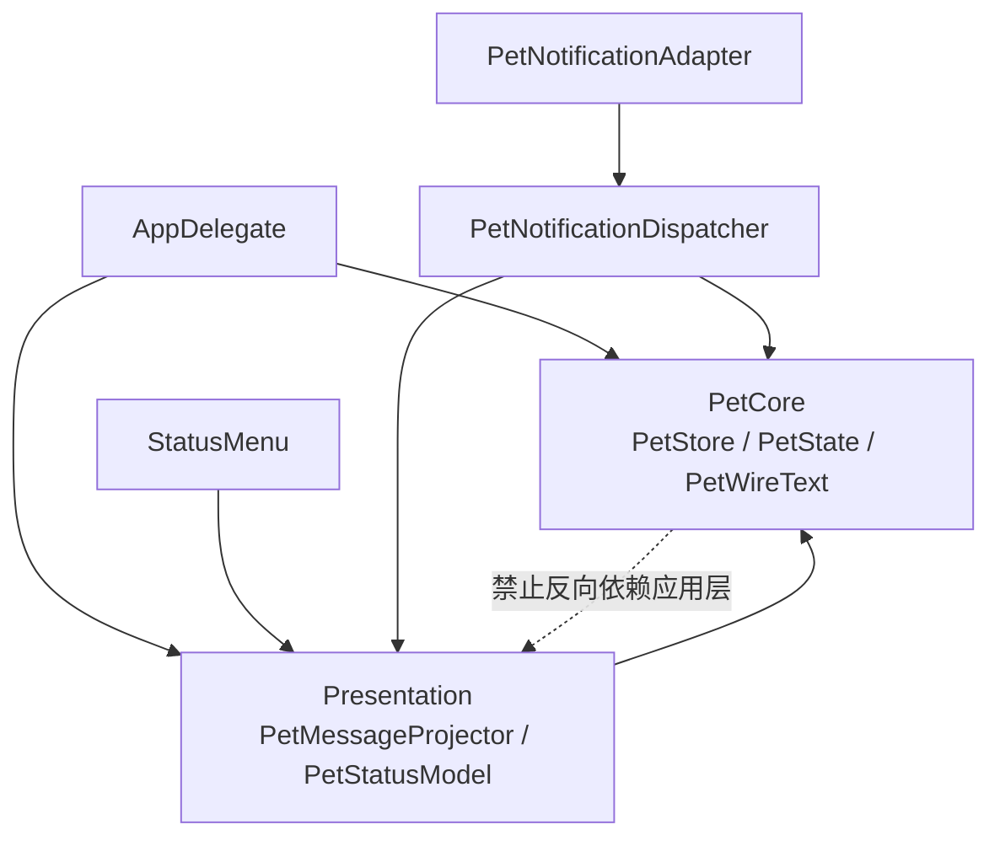

# Implementation Plan: 契约语义对齐与呈现归属

**Delivery**: single PR（计划与实现同一分支：当前 `feat/session-title`，含未提交的 title 基线）。提交与推送在用户确认前不做。

## Overview

先把 wire 上 `title` / `label` 的归一化语义和跨语言输出测试对齐（C3），再用一个可证伪的矩阵复现气泡布局问题，只有复现失败才做测量式裁剪（C2）。随后把用户可见文案从 PetCore、AppDelegate、PetStatusModel、通知 adapter 收进应用层呈现 module（C1），同时收掉 PresentedSession / PresentedFeedback 的逐字段镜像（C7）；姿态仲裁（C5）在改动 `refresh` 时局部抽出。C4（快照与事实统一）和 C6（宿主登记表）暂缓，并记录理由。

## Requirements

- `title` 与 `label` 在 JS 生产者、JS validator、Swift decoder、Swift hook adapter 中采用同一套归一化：去控制/格式字符、去首尾空白、按 Unicode 标量（码点）计数，上限 256；空值置 nil；不再出现“schema/JS 允许 256 字符、Swift 65 字节就丢弃”。
- 共享 fixtures 带**期望输出**，两种语言的契约测试断言同一份归一化结果；无效样例仍断言抛错。
- 气泡布局先有矩阵复现（6/10/15/18/30/64 字 × 等待/完成/并行完成）。矩阵绿则不做 fitting 重构；矩阵红才新增 `PetBubbleFit` 并让气泡文案走测量。
- PetCore 不再产出用户可见中文文案；`PetPresentation.text`、`PresentedFeedback.text`、`PetNotice.title/body` 移除，改为结构化事实。
- 应用层新增 `Presentation/PetMessageProjector`，统一产出气泡、菜单摘要、设置行、通知内容；`SettingsView` 不再调用 `AppDelegate.displayTitle`。
- `PresentedSession` 持有 `SessionSnapshot` 加来源/stale；`PresentedFeedback` 只保留姿态、结果种类、来源与标题，不再复制字段。
- `PetPoseDecision` 承接睡眠/戳/拖/演示的优先级，`AppDelegate.refresh` 只应用；行为不变。
- C4、C6 暂缓的理由写入 `CONTEXT.md` / `docs/architecture.md`，避免下一轮审查重复提出。
- 所有既有检查通过；除统一措辞外，不改用户可见行为。

## Non-goals

- 不把 DSH 快照改成逐条原始事实：快照可重连、可合并，事实不可合并；这会改变协议与重连语义。
- 不做宿主登记表（C6），不接第三个宿主。
- 不把会话标题放进系统通知（当前隐私取舍不变）。
- 不改姿态优先级、通知声音/时长过滤、点击穿透、截图/自动化入口。
- 不改 `contracts/fixtures` 与 `bridge/fixtures` 的双份镜像机制（C5 小项，后续单独处理）。

## Open Decisions

- **Critical**: 无。
- **Important（按假设执行，用户可否决）**：
  - 归一化上限统一为 **256 个 Unicode 标量（码点）**，与 JSON Schema 的 `maxLength: 256` 完全一致；生产者与解码器都对超限值截断到 256，不再使用字节上限。空串归一后为 nil。控制/格式字符由生产者与解码器同样剥离；剥离后为空则视为 nil。schema 的 `maxLength` 是产出上限，不作为解码器拒绝整条消息的理由。
  - 完成文案统一为「本轮回应已结束」（带标题时「「标题」已完成」）；不再区分 DSH 的「任务已完成」与 hook 的「本轮回应已结束」。
  - C2 的“红”定义为：任一矩阵用例测量高度超过两行（32pt）或末尾被截断；矩阵必须用真实字体与气泡可用宽度测量。

## Architecture Changes

当前呈现规则分散在五处：`PetStore` 直接拼中文（21 条字符串）、`AppDelegate.presentationText` 再按姿态重组、`PetStatusModel` 独立拼摘要与行文案、`StatusMenu` 拼静态标题、通知 adapter 直接用 `PetNotice.title/body`。未提交的 title 改动又让 `SettingsView` 反向依赖 `AppDelegate.displayTitle`。这与 AGENTS.md 的「PetCore 不放排版与文案拼接、文字留在应用层」相冲突。

目标是把「状态判定」和「文字呈现」分开：PetCore 只产出姿态、计数、会话、结构化 feedback/notice；应用层一个 projector 把这些事实映射到四个 surface。依赖方向从「Core 产文字、App 再重组」改为「App 依赖 Core 的事实」。

### Target Directory Structure

```text
native/Sources/
├── PetCore/                         # 只依赖 Foundation；不再有用户可见文案
│   ├── PetStore.swift               # 状态、优先级、提醒队列（结构化）
│   ├── PetState.swift               # PetPresentation / PresentedSession / PresentedFeedback / PetNotice
│   ├── BridgeMessage.swift          # 解码与归一化
│   ├── PetWireText.swift            # [new] 256 标量归一化
│   └── ...
├── PetHooks/
│   └── HookAdapter.swift            # label 归一化，与 PetWireText 同规则
└── DSHNativePet/
    ├── Presentation/                # [new] 应用层呈现
    │   ├── PetMessageProjector.swift   # 气泡/菜单/设置/通知文案
    │   ├── PetNotificationContent.swift
    │   ├── PetStatusModel.swift        # [moved from SettingsView.swift]
    │   └── PetBubbleFit.swift          # [new only if C2 red]
    ├── PetPoseDecision.swift        # [new, Phase 4] 纯姿态仲裁
    ├── AppDelegate.swift            # 组合根：窗口/IPC/定时器，应用 projector 结果
    ├── SettingsView.swift           # 只保留 SwiftUI 视图
    ├── StatusMenu.swift             # 显示，不拼动态文案
    └── PetNotifications.swift       # 传输 adapter；内容由 dispatcher 构建
```

### File Change Map

| Current path | Target path | Operation | Responsibility and affected references |
| --- | --- | --- | --- |
| `native/Sources/PetCore/PetState.swift` | 同路径 | modify | 移除 `PetPresentation.text`、`PresentedFeedback.text`、`PetNotice.title/body`；`PresentedSession` 持有 `SessionSnapshot`；新增 `PetFeedbackKind` |
| `native/Sources/PetCore/PetStore.swift` | 同路径 | modify | outcome → `PetFeedbackKind`；notice 只存结构化字段；删除所有中文文案；保留姿态优先级、计数、过期与去重 |
| `native/Sources/PetCore/BridgeMessage.swift` | 同路径 | modify | title/label 走 `PetWireText`；label 上限 64 → 256 标量；不再为超限 title 拒绝整份快照 |
| `native/Sources/PetCore/PetWireText.swift` | 同路径 | add | 去 Cc/Cf、trim、按 Unicode 标量截断到 256、空值 nil；Swift 单一常量 |
| `native/Sources/PetHooks/HookAdapter.swift` | 同路径 | modify | cwd label 使用同一归一化；删除本地 64 字节常量 |
| `native/Sources/DSHNativePet/Presentation/PetMessageProjector.swift` | 同路径 | add | 四个 surface 的唯一文案来源；标题截断/换行；C2 红时调用 `PetBubbleFit` |
| `native/Sources/DSHNativePet/Presentation/PetNotificationContent.swift` | 同路径 | add | title/body/sound/thread/userInfo 的传输值 |
| `native/Sources/DSHNativePet/SettingsView.swift` 中的 `PetStatusModel` | `native/Sources/DSHNativePet/Presentation/PetStatusModel.swift` | move + modify | 先纯移动，再让摘要与行文案委托 projector |
| `native/Sources/DSHNativePet/SettingsView.swift` | 同路径 | modify | 删除 `PetStatusModel` 与 `displayTitle` 调用，只保留视图 |
| `native/Sources/DSHNativePet/AppDelegate.swift` | 同路径 | modify | `refresh` 用 projector 产出气泡；删除 `presentationText`/`displayTitle`；通知 dispatcher 注入 projector；Phase 4 用 `PetPoseDecision` |
| `native/Sources/DSHNativePet/StatusMenu.swift` | 同路径 | modify | 动态摘要来自 projector；静态菜单标签保留 |
| `native/Sources/DSHNativePet/PetNotifications.swift` | 同路径 | modify | adapter 接收 `PetNotificationContent`；dispatcher 构建内容；声音/时长策略不变 |
| `native/Sources/DSHNativePet/PetPoseDecision.swift` | 同路径 | add | 纯函数：presentation + 时间 + 交互标志 → 姿态 |
| `bridge/lib/text.js` | 同路径 | add | JS 归一化（与 `PetWireText` 同规则） |
| `bridge/lib/session-state.js` | 同路径 | modify | `cleanTitle` 用标量上限；title 事件路径不变 |
| `bridge/lib/protocol.js` | 同路径 | modify | `decodeMessage` 对 title/label 做归一化；上限常量与 text.js 一致 |
| `bridge/lib/index.js` | 同路径 | modify | 初始 title 仍走 projection，无行为变化 |
| `contracts/bridge.schema.json` | 同路径 | modify | 明确 256 码点上限；与运行时标量计数一致 |
| `contracts/fixtures/{snapshots,activity,invalid-messages}.json` | 同路径 | modify | 增加 64/65/256/257 标量、控制字符、CJK 边界；有效样例带 `normalized` 期望输出 |
| `bridge/fixtures/*` | 同路径 | modify | 与 contracts 逐字节镜像 |
| `scripts/check-contracts.mjs` | 同路径 | modify | 校验 `normalized` 与镜像一致 |
| `bridge/e2e/contract.e2e.mjs`、`native/Tests/PetCoreTests/ContractTests.swift` | 同路径 | modify | 两端断言同一归一化输出 |
| `native/Tests/PetCoreTests/{PetStoreTests,ActivityStoreTests}.swift` | 同路径 | modify | 断言结构化 feedback/notice，不针断言文案 |
| `native/Tests/PetAppTests/{SessionTitleTests,PetNotificationTests,PetEventDispatcherTests,PetAssetsTests}.swift` | 同路径 | modify | 改用 projector；新增通知内容断言 |
| `native/Tests/PetAppTests/PetMessageProjectorTests.swift` | 同路径 | add | 四端文案、标题、等待/完成、无宿主、睡眠、错误 |
| `native/Tests/PetAppTests/BubbleLayoutMatrixTests.swift` | 同路径 | add | C2 复现矩阵 |
| `native/Tests/PetAppTests/PetPoseDecisionTests.swift` | 同路径 | add | 60s 睡眠、戳、拖、演示、挂起 |
| `docs/architecture.md`、`CONTEXT.md`、`docs/host-hooks.md` | 同路径 | modify | 呈现归属、归一化、C4/C6 暂缓理由 |

### Module Responsibilities and Interfaces

| Module/path | Current responsibility | Proposed responsibility and public interface | State/resource owner |
| --- | --- | --- | --- |
| `PetCore/PetStore` | 状态 + 中文文案 + 提醒 | 状态、优先级、结构化 feedback/notice；无文案 | 会话/回合/提醒队列 |
| `PetCore/PetWireText` | 无 | `normalize(_:)`；单一 256 标量常量 | 无 |
| `Presentation/PetMessageProjector` | 分散在 App/Model/Adapter | `bubble(pose:presentation:connectionError:)`、`summary`、`sessionRow`、`notificationContent`；唯一文案来源 | 无（纯投影） |
| `Presentation/PetStatusModel` | 设置视图文件内的 ObservableObject | 只维护状态并调用 projector；不再依赖 AppDelegate | 菜单/设置展示状态 |
| `AppDelegate` | 组合根 + 文案 + 姿态 | 组合根：窗口、IPC、定时器、系统生命周期；应用 projector/pose 结果 | 窗口、定时器、IPC |
| `PetNotifications` | adapter 直接用 notice 文案 | adapter 只投递 `PetNotificationContent`；过滤/声音策略留在 dispatcher | 系统通知权限/投递 |
| `PetPoseDecision` | 埋在 `refresh` | 纯姿态仲裁；行为与现有优先级一致 | 无 |

### Architecture and Dependency Direction



箭头表示静态依赖；红色虚线为禁止边，由 SwiftPM target 依赖与 `scripts/check-boundaries.mjs` 保证。运行时数据流仍是：socket/helper → `PetStore` → `PetPresentation` → projector → 窗口/菜单/通知。

必须保留的行为：等待优先级高于执行/思考/反馈；计数与 stale/过期规则；通知只在等待/出错发声、短回合不通知；点击通知定位会话；截图/自动化入口；角色切换与窗口尺寸。

## Ownership Map

| Path | Owner |
| --- | --- |
| `docs/plans/2026-10-25-contract-and-presentation.md` | 规划者（本会话） |
| `native/Sources/PetCore/*`、`native/Sources/PetHooks/*` | Codex（单一实现者） |
| `native/Sources/DSHNativePet/Presentation/*` | Codex |
| `native/Sources/DSHNativePet/{AppDelegate,SettingsView,StatusMenu,PetNotifications,PetPoseDecision}.swift` | Codex |
| `bridge/lib/*`、`bridge/fixtures/*` | Codex |
| `contracts/*`、`scripts/check-contracts.mjs`、测试、文档 | Codex（共享契约由整合者持有） |

## Implementation Steps

### Phase 1: 契约语义与输出测试（C3）

1. **归一化规则与常量**（File: `native/Sources/PetCore/PetWireText.swift`、`bridge/lib/text.js`）
   - Action: 新增同规则实现：去 `Cc/Cf`、trim、按 Unicode 标量截断 256、空值 nil；导出 Swift/JS 常量。
   - Why: 当前两端上限不同，必须先把语义定死。
   - Expected result: 64/65/256/257 标量与 CJK 边界有确定输出。
   - Verify: 新增/更新单测覆盖边界。
   - Dependencies: None
   - Risk: Low（标量计数由语言原生支持）

2. **JS 生产者与 validator**（File: `bridge/lib/session-state.js`、`bridge/lib/protocol.js`）
   - Action: `cleanTitle` 改用 `text.js`；`decodeMessage` 对 title/label 归一化；上限常量统一。
   - Why: schema/JS 与 Swift 行为对齐。
   - Expected result: 100 字符 label 在两边得到同一值。
   - Verify: `npm --prefix bridge test`
   - Dependencies: Step 1
   - Risk: Low

3. **Swift 解码与 hook label**（File: `BridgeMessage.swift`、`HookAdapter.swift`）
   - Action: label 64 → 256 标量；title/label 归一化而非超限丢弃/拒绝整份快照；保留必需字段严格校验。
   - Why: 消除“合法却被静默丢弃”的分歧。
   - Expected result: 同一 fixture 两种语言输出一致。
   - Verify: `swift test --filter ContractTests`、`HookAdapterTests`
   - Dependencies: Step 1
   - Risk: Medium（快照不再因 title 超限被整体拒绝）

4. **fixtures 增加期望输出**（File: `contracts/fixtures/*`、`bridge/fixtures/*`）
   - Action: 有效样例增加 `normalized`（完整归一化消息，含 null 字段）；新增 64/65/256 标量、控制字符、CJK 边界；257 与更长的截断只在归一化单测覆盖；invalid 保持类型错误。
   - Why: fixtures 目前只有样本，没有可断言的输出。
   - Expected result: 两端都能对同一 `normalized` 做相等断言。
   - Verify: `node scripts/check-contracts.mjs`
   - Dependencies: Steps 1–3
   - Risk: Medium（Swift 编码需 canonical 比较）

5. **契约测试两端断言**（File: `ContractTests.swift`、`bridge/e2e/contract.e2e.mjs`、`protocol.test.mjs`、`check-contracts.mjs`）
   - Action: 有效样例解码后与 `normalized` 相等；无效样例仍抛错；镜像逐字节一致。
   - Why: 把“对齐”变成可执行断言。
   - Expected result: 任一语言改动导致漂移时测试变红。
   - Verify: `npm --prefix bridge test`、`swift test`、`node scripts/check-contracts.mjs`
   - Dependencies: Step 4
   - Risk: Low

6. **文档**（File: `docs/architecture.md`、`docs/host-hooks.md`）
   - Action: 写明 256 标量归一化、截断而非丢弃、schema 上限的含义。
   - Why: 避免读者误以为 schema 是运行时唯一校验。
   - Expected result: 文档与 fixtures 一致。
   - Verify: 人工核对
   - Dependencies: Steps 1–5
   - Risk: Low

### Phase 2: 气泡布局复现（C2 gate）

1. **矩阵测试**（File: `native/Tests/PetAppTests/BubbleLayoutMatrixTests.swift`）
   - Action: 6/10/15/18/30/64 字标题 × 等待/完成/并行完成；用 11pt、气泡可用宽度（`bounds.width - 14`）与真实 `PetView` 结构测量行数/高度；任一例超过两行或 32pt 即失败并打印用例。
   - Why: 现有测试只断言高度 ≤32 与文本相等，未证明字符完整可见。
   - Expected result: 得到明确的红/绿清单。
   - Verify: `swift test --filter BubbleLayoutMatrix`
   - Dependencies: None（可在 Phase 1 后并行）
   - Risk: Low（测量方式需与 PetView 一致）

2. **判定与记录**（File: 计划文档/PR 描述）
   - Action: 记录矩阵结果；若绿，C2 关闭，不新增 fitting；若红，进入 Step 3。
   - Why: 用户要求先复现再重构。
   - Expected result: 有证据的决策。
   - Verify: 测试输出
   - Dependencies: Step 1
   - Risk: Low

3. **仅在红时：测量式裁剪**（File: `Presentation/PetBubbleFit.swift`、`PetMessageProjector.swift`）
   - Action: 用真实字体测量、按 grapheme 边界截断/断行，调用方传完整标题与状态；删除 15/12/16/10 分支上限。
   - Why: 字符预算是在猜布局。
   - Expected result: 矩阵全绿。
   - Verify: `swift test --filter BubbleLayoutMatrix`、`SessionTitleTests`
   - Dependencies: Step 2 判定为红
   - Risk: Medium

### Phase 3: 文案归属与镜像收敛（C1 + C7）

1. **Core 结构化事实**（File: `PetState.swift`、`PetStore.swift`）
   - Action: 新增 `PetFeedbackKind`；`PresentedFeedback` 改为 `pose/kind/sourceLabel/title`；`PetNotice` 去掉 title/body；`PetPresentation` 去掉 text；`PresentedSession` 持有 `session` + source/stale。
   - Why: 文案不再属于 Core；镜像字段只存一处。
   - Expected result: Core 不再有用户可见中文串；调用点能读取结构化事实。
   - Verify: `swift test --filter PetCoreTests`
   - Dependencies: Phase 1（fixtures 字段稳定）
   - Risk: High（公共类型变化）

2. **App 呈现 module**（File: `Presentation/PetMessageProjector.swift`、`PetNotificationContent.swift`）
   - Action: 把所有 surface 文案集中到 projector；提供 bubble/summary/sessionRow/notificationContent；带标题时统一「「标题」已完成」等；C2 红时调用 fit。
   - Why: 一个 interface、四个 surface。
   - Expected result: AppDelegate/PetStatusModel/StatusMenu/Dispatcher 只调用 projector。
   - Verify: 新增 `PetMessageProjectorTests`
   - Dependencies: Step 1
   - Risk: Medium

3. **移动 PetStatusModel**（File: `SettingsView.swift` → `Presentation/PetStatusModel.swift`）
   - Action: 先纯移动不改内容，再改为委托 projector；删除对 `AppDelegate.displayTitle` 的依赖。
   - Why: 去掉反向依赖，模型与视图分离。
   - Expected result: `SettingsView` 只保留视图。
   - Verify: `swift build`、`PetStatusModel` 相关测试
   - Dependencies: Step 2
   - Risk: Low

4. **通知链路**（File: `PetNotifications.swift`、`AppDelegate.swift`）
   - Action: `PetNotificationAdapter.submit` 接收 `PetNotificationContent`；dispatcher 用 projector 构建内容；声音/时长过滤保持在 dispatcher；录制 adapter 记录内容。
   - Why: adapter 不再依赖 Core 文案。
   - Expected result: 通知内容与气泡文案同源。
   - Verify: `PetNotificationTests`
   - Dependencies: Step 2
   - Risk: Medium（协议变化）

5. **AppDelegate 组合根**（File: `AppDelegate.swift`）
   - Action: `refresh` 用 projector 产出气泡；删除 `presentationText`/`displayTitle`；demo/错误覆盖保留但走 projector 参数。
   - Why: 组合根只应用，不再排版。
   - Expected result: `refresh` 无中文文案拼接；捕获/自动化行为不变。
   - Verify: `PetNotificationTests`、capture 测试
   - Dependencies: Steps 2, 4
   - Risk: Medium

6. **测试迁移与补充**（File: `PetStoreTests`、`ActivityStoreTests`、`SessionTitleTests`、`PetNotificationTests`、`PetEventDispatcherTests`、`PetAssetsTests`）
   - Action: Core 断言结构化事实；App 断言 projector 输出；标题/等待/并行/无标题/睡眠/通知内容全覆盖。
   - Why: 旧文案断言不再属于 Core 的 interface。
   - Expected result: 测试通过，无对已删除字段的引用。
   - Verify: `swift test`
   - Dependencies: Steps 1–5
   - Risk: Medium（测试量大）

7. **文档**（File: `docs/architecture.md`、`CONTEXT.md`）
   - Action: 更新呈现归属、`PetNotice`/`PetPresentation` 字段、来源前缀与标题规则；记录 C4 暂缓理由（快照可重连、事实不可合并）。
   - Why: 让后续读者不把两种输入模型当重复。
   - Expected result: 文档与代码一致。
   - Verify: 人工核对
   - Dependencies: Steps 1–6
   - Risk: Low

### Phase 4: 姿态仲裁局部整理（C5）

1. **纯决策 module**（File: `PetPoseDecision.swift`）
   - Action: 输入 presentation、now、lastInteraction、lastActivity、pokeUntil、dragging、demoPose；输出 pose；保持现有优先级与 60 秒规则。动画开关与系统挂起仍留在 AppDelegate，不纳入本次策略。
   - Why: 睡眠/戳/拖优先级目前不可直接测试。
   - Expected result: `refresh` 只调用并应用。
   - Verify: 新增 `PetPoseDecisionTests`；capture 行为不变
   - Dependencies: Phase 3
   - Risk: Medium

### Phase 5: 文档与收尾

1. **C4/C6 暂缓记录**（File: `CONTEXT.md`、`docs/architecture.md`）
   - Action: 写清 DSH 快照可重连/可合并、hook 是逐条事实，不统一为原始事实；宿主登记表等第三个宿主再做。
   - Why: 避免下一轮审查重复提出。
   - Expected result: 决策可追溯。
   - Verify: 人工核对
2. **计划状态更新**（File: 本计划）
   - Action: 记录 C2 矩阵结果、实际改动与遗留项。
   - Verify: 文档一致

## Testing Strategy

- **Unit**：`PetWireText` 归一化、`BridgeMessage`/`HookAdapter` 边界、`PetMessageProjector` 四端文案、`PetPoseDecision` 优先级、`PetStore` 结构化 feedback/notice。
- **Contract**：`contracts/fixtures` 的 `normalized` 在 JS/Swift 两端相等；镜像逐字节一致；无效样例两类都抛错。
- **Integration**：通知 dispatcher 产出的内容、设置行/菜单摘要、点击定位、录制 adapter。
- **Layout**：`BubbleLayoutMatrixTests`；C2 红时的 fitting 回归。
- **E2E**：`npm --prefix bridge run test:e2e`（真实 DSH Host + 契约）；必要时 `test:native`（需要已打包应用）。

## Final Verification

```sh
npm --prefix bridge test
npm --prefix bridge run test:e2e
node scripts/check-contracts.mjs
node scripts/check-boundaries.mjs
CLANG_MODULE_CACHE_PATH="$PWD/native/.build/clang-cache" \
SWIFTPM_MODULECACHE_OVERRIDE="$PWD/native/.build/swiftpm-cache" \
swift test --package-path native --disable-sandbox
CLANG_MODULE_CACHE_PATH="$PWD/native/.build/clang-cache" \
SWIFTPM_MODULECACHE_OVERRIDE="$PWD/native/.build/swiftpm-cache" \
swift build --package-path native --disable-sandbox --product DSHNativePet
```

额外检查：`rg` 确认 `native/Sources/PetCore` 的用户可见中文字符串为 0；`rg` 确认 `presentationText|displayTitle` 不再存在。

## Risks & Mitigations

- **Risk**: Phase 3 公共类型改动大，测试与调用点连锁。
  - Mitigation: 先加 projector 与新字段，再切换调用点，最后删除旧字段；分步编译，最后一次性提交测试更新。
- **Risk**: `normalized` fixtures 在 Swift 侧的 canonical JSON 比较不稳定。
  - Mitigation: 用 `JSONSerialization` 转 `NSDictionary` 比较，忽略键序；只比较 wire 字段，不比较 Swift 类型。
- **Risk**: 矩阵测量与 SwiftUI 实际渲染有偏差。
  - Mitigation: 同时断言 `PetView.bubbleFrame` 与 `NSAttributedString` 测量；以实际 `displayText` 与高度为准。
- **Risk**: 统一措辞改变用户可见文案。
  - Mitigation: 只在 projector 一处改，测试固定新文案；如用户否决，projector 加 source kind 分支即可。
- **Risk**: C4 暂缓后两套 300ms 去抖仍在。
  - Mitigation: 文档记录；`snapshotWaiting` 补注释“快照已去抖”，把它变成显式知识。

## Remaining Risks

- C4（快照/事实统一）仍会产生跨语言语义同步成本；只有改等待/终态语义时才值得重新评估。
- C6（宿主登记表）未做；接第三个宿主时仍需改六处。
- C2 若矩阵为绿，字符上限仍留在 projector 内，属于已知但未证实的布局风险。
- 系统通知仍不含会话标题（隐私取舍）。

## Success Criteria

- [x] `title`/`label` 在 JS 与 Swift 的归一化输出一致；64/65/256 标量 fixture 有期望值并通过，257 的截断有单测。
- [x] schema、JS validator、Swift decoder 的 256 标量语义在文档中一致。
- [x] `BubbleLayoutMatrixTests` 结果已记录；初测 24/36 红，修复后 36/36 绿。
- [x] `PetCore` 无用户可见中文文案；`PetPresentation.text`、`PresentedFeedback.text`、`PetNotice.title/body` 已移除。
- [x] `PetMessageProjector` 是气泡/菜单/设置/通知动态文案的唯一来源；`SettingsView` 不再依赖 `AppDelegate`。
- [x] `PresentedSession` 持有 `SessionSnapshot`；无逐字段镜像。
- [x] `PetPoseDecision` 有直接测试，`refresh` 行为不变。
- [x] C4/C6 暂缓理由写入 `CONTEXT.md` / `docs/architecture.md`。
- [x] Final Verification 通过（见下方复核记录）。

## Phase 1/2 Execution Evidence（2026-10-25）

执行者：Codex，沿用 `feat/session-title`，只执行 Phase 1/2。
以本轮开始时的主仓库和 bridge 未提交内容为基线，基线文件均保留；未提交、未 push，未开始 Phase 3/4/5。

### C3 契约结果

生产者 → wire → 解码器统一走 JS `normalizeWireText` / Swift `PetWireText.normalize`：去 Cc/Cf、trim、截断至 256 个 Unicode 标量，空值转 null。
Swift hook label 的 64 字节规则和 snapshot title 超限拒绝规则按计划替换。
有效 fixtures 共 54 项，`normalized` 为完整 wire 消息：缺省 title/label 补 null，保留 turn/result/turnId/toolId 的显式 null，剥离 v 和各层未知字段。
JS deepEqual 与 Swift 解码后重新编码、排序 JSON 键的 canonical Data 比较均通过。
64/65/256 标量覆盖 ASCII、CJK、补充平面字符，并覆盖 Cc/Cf、空串、Unicode 空白、组合字符和 CJK 混合边界。
257/1024 标量截断在归一化、解码及生产者单测覆盖，不加入 wire fixtures。
59 项 invalid fixtures 保留原始内容，继续要求 schema 不接受且两端解码抛错。
两份 snapshots/activity/invalid-messages fixtures 逐字节一致。

schema 的 title/label 移除 `minLength: 1`，使空串输入可归一成 null；保留 `maxLength: 256` 作为生产者输出上限，解码器仍接受超限字符串并截断。
首次以新增 expected output 运行 JS 契约 E2E：115 项中 23 项失败；实现后 115 项全部通过。

### C2 矩阵与决策

真实链路为 PetStore → AppDelegate.presentationText → PetView.render → SwiftUI 气泡布局。
矩阵为 6/10/15/18/30/64 字 CJK 标题 × 等待/完成/并行完成 × 两套角色，共 36 个用例，人物高度 100pt。
气泡宿主宽度为 `bounds.width - 14`（本矩阵为 126pt），SwiftUI 水平 padding 每侧 7pt，实际文本宽度为 112pt。
使用 11pt medium 字体、NSAttributedString 和 TextKit 测量行数/高度，并用不限制行数的 SwiftUI 对照视图检查实际截断；同时检查 PetView.bubbleFrame。

| 标题字数 | 等待（修复前） | 完成（修复前） | 并行完成（修复前） |
| --- | --- | --- | --- |
| 6 | 绿 | 绿 | 绿 |
| 10 | 绿 | 绿 | 红：3 行 / 44pt |
| 15 | 红：3 行 / 43pt | 绿 | 红：3 行 / 44pt |
| 18 | 红：3 行 / 43pt | 红：3 行 / 43pt | 红：3 行 / 44pt |
| 30 | 红：3 行 / 43pt | 红：3 行 / 43pt | 红：3 行 / 44pt |
| 64 | 红：3 行 / 43pt | 红：3 行 / 43pt | 红：3 行 / 44pt |

两套角色结果相同，修复前 24/36 个用例超限，因此新增 `Presentation/PetBubbleFit.swift`。
AppDelegate 传完整标题、原有状态文案与实际气泡宽度，fitter 按 grapheme 边界缩短标题并加省略号，保留状态文字，替换原 15/12/16/10 字预算。
修复后 36/36 全绿，最多两行，带 padding 的测量高度最高 31pt，实际 SwiftUI 气泡最高 32pt，无对照视图截断。
另有不同宽度、组合字符及 ZWJ emoji 的 grapheme 边界测试通过。

计划 Step 3 提到通过 PetMessageProjector 接入 fitting；本轮按用户“不要顺手做 Phase 3 的文案迁移”要求，接入保留在 AppDelegate，未新增 projector。
测量断言区分 AppKit 与 SwiftUI 的标点换行差异：AppKit 测量用于两行/32pt gate，实际是否被裁切由无限行 SwiftUI 对照视图与 PetView.bubbleFrame 比较。
未改 PetView 布局、菜单/设置文案职责、Core 呈现类型或通知链路。

### 本轮改动文件（相对本轮未提交基线）

- 主仓库契约：`contracts/bridge.schema.json`、`contracts/fixtures/snapshots.json`、`contracts/fixtures/activity.json`、`scripts/check-contracts.mjs`。
- Swift 归一化：`native/Sources/PetCore/PetWireText.swift`（新增）、`native/Sources/PetCore/BridgeMessage.swift`、`native/Sources/PetHooks/HookAdapter.swift`。
- 应用层布局：`native/Sources/DSHNativePet/Presentation/PetBubbleFit.swift`（新增）、`native/Sources/DSHNativePet/AppDelegate.swift`。
- Swift 测试：`native/Tests/PetCoreTests/ContractTests.swift`、`native/Tests/PetHooksTests/HookAdapterTests.swift`、`native/Tests/PetAppTests/BubbleLayoutMatrixTests.swift`（新增）、`native/Tests/PetAppTests/SessionTitleTests.swift`（保留基线测试并更新裁剪期望）。
- 文档：`docs/architecture.md`、`docs/host-hooks.md`、本计划（只追加执行结果）。
- bridge：`lib/text.js`（新增）、`lib/session-state.js`、`lib/protocol.js`、`fixtures/snapshots.json`、`fixtures/activity.json`、`e2e/contract.e2e.mjs`、`test/protocol.test.mjs`、`test/session-state.test.mjs`。

### 验证与未完成验收

| 检查 | 结果 |
| --- | --- |
| `npm --prefix bridge test` | 30 通过，5 项因 Unix socket listen EPERM 跳过，0 失败 |
| `node scripts/check-contracts.mjs` | 通过，包含输入/normalized schema、输出相等、invalid 抛错、镜像校验 |
| 指定 Swift 筛选 `ContractTests\|HookAdapterTests\|BubbleLayoutMatrix` | 19 项通过 |
| 含 SessionTitleTests 的 Swift 筛选（新增 grapheme 测试前） | 23 项通过 |
| `node --test bridge/e2e/contract.e2e.mjs` | 115 项通过 |
| `npm --prefix bridge run test:e2e` | 115 通过，真实 DSH Host 测试 1 项因 socket listen EPERM 失败 |
| Swift 全量 | 已运行，出现下列 socket 失败；进程返回 0 但未输出 Swift Testing 最终汇总，不能视为全量通过 |
| `node scripts/check-boundaries.mjs` | 通过 |
| 主仓库与 bridge 的 `git diff --check` | 通过 |

Swift 使用用户指定的仓库内 Clang/SwiftPM 缓存和 `--disable-sandbox`。
Swift 全量记录的失败为 `HookTransportTests.realSocketReceivesOneNewlineDelimitedEvent`（`socket(1)`）、`SocketProbeTests.connectsToListenerThenClosesWithoutSendingActivity`（bind EPERM），以及 `UnixSocketServerTests` 的以下用例（均为 bind EPERM）：

- `shortLivedSnapshotCompletionIsSilentAndEOFRemovesSession`
- `shortLivedActivityEOFDeliversStopAndPreservesSessionWithoutHeartbeat`
- `activityAndSnapshotConnectionModesCannotMix`
- `consecutiveShortLivedActivityConnectionsDoNotDropFramesOrDisconnectSources`
- `fragmentedAndCoalescedFramesDiscardStaleSequence`
- `sourceReplacementDoesNotLetOldCloseRemoveNewSource`
- `identityChangeAndInvalidFrameFinalizeExactlyOnce`
- `invalidOversizedFrameDisconnectsAndRestartReacquiresLock`
- `inactivityExpiresWithoutCompletionOrDuplicateDisconnect`
- `incompatibleVersionClosesOnlyItsClient(newline:)`（true/false 两个参数均失败）

JS 跳过的 socket 用例覆盖重连/心跳、背压合并、同 tick 合并、编码失败清理、宿主挂载与释放。
真实 DSH Host E2E 失败用例为 `real DSH Host turns, tools, approvals, two sources, late mounting, HMR and cancellation reach the socket`。
上述 socket 集成与 Swift 全量最终汇总需在沙箱外复跑；本轮未修改这些范围外测试。
布局证据限于真实 PetView/SwiftUI 测量，未执行打包应用截图验收。
本机详细日志保存在 `/tmp/pet-contract-before.log`、`/tmp/pet-matrix-before.log`、`/tmp/pet-targeted-final.log`、`/tmp/pet-bridge-test.log`、`/tmp/pet-e2e-full.log`、`/tmp/pet-swift-full-final.log`。

## Phase 3 Execution Evidence（2026-10-25）

执行者：Codex，沿用 `feat/session-title`，保留全部未提交基线，未提交或 push。
本轮只实施 Phase 3；姿态仲裁仍在 AppDelegate，未开始 Phase 4/5。
Phase 1/2 的 bridge、schema、fixtures、归一化实现和 PetBubbleFit 与本轮开始的备份逐文件哈希一致。

### 字段决策与用户纠正

迁移时发现原计划的四类 PetNoticeKind 无法还原 blocked/maxTokens/other 通知正文，feedback 四字段也无法保留 DSH/hook 的文案差异，因此先提出字段冲突。
用户确认：“给 `PetNotice` 增加 `feedback: PetFeedbackKind?`”，并明确“不要给 PresentedFeedback 加 sourceId”。
实际保留四类 PetNoticeKind，新增可选反馈种类；waiting 为 nil，ended 为 completed/blocked/maxTokens/other，error 为 failed，interrupted 为 interrupted。
PresentedFeedback 保持 pose/kind/sourceLabel/title，snapshot 与 hook 都提供来源标签；完成、失败、中断等正文按用户给定映射统一，不再按来源类别分支。
用户确认“`PetPresentation.hasReceivedHook` 保留”，用于保留首次无宿主与 hook 历史退出后就绪的区别。
通知传输值额外保留 sourceLabel，因为现有 capture JSONL 消费者使用这个字段；userInfo 仍只包含 sourceId/sessionId，点击行为不变。

### 最终职责与链路

PetStore 保留原有状态转换、优先级、计数、去重、等待去抖、过期与提醒队列，输出结构化 PetPresentation/PetNotice。
PresentedSession 持有 SessionSnapshot 与来源/stale，不复制 session 字段。
Core 的 PetPresentation.text、PresentedFeedback.text、PetNotice.title/body 均删除。

PetStatusModel 先从 SettingsView 原样移动到 Presentation，再委托 projector 产生摘要和会话行。
AppDelegate 将 presentation、最终 pose、实际气泡宽度和 connectionError 交给 projector，随后更新 PetView。
demo 文字覆盖仍在 AppDelegate，连接异常继续优先于 demo；60 秒睡眠、poke/drag/demo 优先级不变。
临时 poke/drag 继续显示底层聚合状态文字，避免标题排版迁移改变交互期间的显示。
通知链路为 PetStore.drainNotices → dispatcher 时长/开关/声音策略 → projector.notificationContent → adapter。
System adapter 只复制投影内容到 UserNotifications；Recording adapter 保存相同 content，并扩充 JSONL 记录 sound/threadIdentifier/userInfo，保留原有元数据键。

主要 projector 接口：

- `bubble(_:pose:bubbleWidth:connectionError:) -> String`：实际宽度为 PetView.bounds.width - 14，标题裁剪继续调用原 PetBubbleFit。
- `summary(_:) -> String`：菜单与设置共用摘要。
- `sessionRow(_:) -> SessionRow`：稳定 id、title、detail。
- `notificationContent(_:sound:) -> PetNotificationContent`：dispatcher 显式传入声音决策。
- `phaseTitle(_:)`、`sessionTitle(_:limit:)`、`rowID(sourceId:sessionId:)`、`sourceSummary(_:)`、`connectionError(_:)`、`notificationStatus(_:)`：应用层共享映射。

### 文案映射

| 事实 | 反馈正文 / 通知正文 |
| --- | --- |
| waiting | 有待处理请求，请查看来源标签；气泡沿用等待数量或标题文案 |
| completed | 本轮回应已结束；带标题的气泡为「标题」已完成 |
| failed / error | 本轮回应出错，请查看来源标签 |
| interrupted | 本轮回应已中断 |
| blocked | 任务受阻，请查看来源标签 |
| maxTokens | 达到输出上限 |
| other | 本轮已结束 |

通知标题默认保持“来源标签 会话提醒”；开启「在通知中显示会话标题」后改为“来源标签 · 标题”，正文、声音与点击行为不变。
普通无标题气泡反馈统一使用“来源标签：反馈正文”；有来源的并行完成使用“来源标签\n本轮结束 · N 执行中/思考中”，有标题时使用标题替代来源。
设置 completed 行文案统一为“本轮回应已结束”；其余 phase、等待、睡眠、无宿主、状态待确认与连接异常文案保留。

### 本轮改动文件

- 新增 `native/Sources/DSHNativePet/Presentation/PetMessageProjector.swift`、`PetNotificationContent.swift`、`PetStatusModel.swift`（从 SettingsView 移出）。
- 修改 `native/Sources/PetCore/PetState.swift`、`PetStore.swift`。
- 修改 `native/Sources/DSHNativePet/AppDelegate.swift`、`AppDelegate+Capture.swift`、`SettingsView.swift`、`StatusMenu.swift`、`PetNotifications.swift`。
- 新增 `native/Tests/PetAppTests/Presentation/PetMessageProjectorTests.swift`。
- 修改 `native/Tests/PetAppTests/SessionTitleTests.swift`、`BubbleLayoutMatrixTests.swift`、`PetNotificationTests.swift`、`PetEventDispatcherTests.swift`、`PetAssetsTests.swift`、`PetSkinTests.swift`。
- 修改 `native/Tests/PetCoreTests/PetStoreTests.swift`、`ActivityStoreTests.swift`，以及 `native/Tests/PetIPCTests/UnixSocketServerTests.swift` 的嵌套 session 访问。
- 更新 `docs/architecture.md`、`CONTEXT.md`，本计划只追加执行记录。

### 验证与遗留验收

全部 Swift 命令使用仓库内 Clang/SwiftPM 缓存及 `--disable-sandbox`。

| 检查 | 结果 |
| --- | --- |
| `swift build --package-path native --disable-sandbox --product DSHNativePet` | 通过 |
| `swift test --package-path native --disable-sandbox` | 已运行；socket 权限失败，菜单用例触发进程提前退出，没有最终 Swift Testing 汇总，不能视为全量通过 |
| 排除下述环境相关用例的 Swift 测试 | 141 项全部通过，有最终汇总；未修改被排除测试的判定标准 |
| `npm --prefix bridge test` | 30 通过，5 项 Unix socket listen EPERM 跳过，0 失败 |
| `node scripts/check-contracts.mjs` | 通过 |
| `node scripts/check-boundaries.mjs` | 通过 |
| `git diff --check`（主仓库及 bridge） | 通过 |
| `rg 'presentationText\|displayTitle' native/Sources native/Tests` | 0 匹配 |
| PetCore 中文字符串检索 | 0 用户可见中文字符串；保留 PetActivityEvent 的一条中文注释 |
| C2 气泡矩阵 | projector 调用链下 36/36 用例通过，组合字符和宽度测试通过 |

socket 失败项：

- `HookTransportTests.realSocketReceivesOneNewlineDelimitedEvent`、`cliDeliversToRealSocketAndExitsWithoutWaitingForReply`：`socket(1)`。
- `SocketProbeTests.connectsToListenerThenClosesWithoutSendingActivity`：bind Operation not permitted。
- `UnixSocketServerTests`：shortLivedSnapshotCompletionIsSilentAndEOFRemovesSession、shortLivedActivityEOFDeliversStopAndPreservesSessionWithoutHeartbeat、activityAndSnapshotConnectionModesCannotMix、consecutiveShortLivedActivityConnectionsDoNotDropFramesOrDisconnectSources、fragmentedAndCoalescedFramesDiscardStaleSequence、sourceReplacementDoesNotLetOldCloseRemoveNewSource、identityChangeAndInvalidFrameFinalizeExactlyOnce、invalidOversizedFrameDisconnectsAndRestartReacquiresLock、inactivityExpiresWithoutCompletionOrDuplicateDisconnect、incompatibleVersionClosesOnlyItsClient(newline: true/false)，均为 bind Operation not permitted。

菜单与视频未完成验收项：

- `PetNotificationTests.sourceRowsHaveStableDistinctIdentityAndMenuShowsHosts`：单独运行停在 started，进程返回 0，没有 passed 或最终汇总。
- `PetSkinTests.menuPreferencesSwitchSamePoseWithoutResettingDSHState`：单独运行同样停在 started，无最终汇总。
- `PetSkinTests.videoDecodesTransparentFramesAndReleasesOnAnimationOffAndSkinSwitch`：单独运行仍在约 4 秒后 decoded 为 nil，并记录 sysctlbyname 权限错误；该测试方法及视频实现与基线一致。

为取得完整结果，可运行集合排除了 UnixSocketServerTests 整个 suite、上述两个 HookTransport socket 测试、SocketProbe listener 测试、两个菜单测试及视频解码测试。
这一集合共 141 项，全部通过；排除整个 socket suite 也包含其不绑定 socket 的 failedPreparation 测试，该项已在全量日志中通过。
实际菜单栏、视频解码与 socket 集成仍需在用户的沙箱外环境复跑，不以当前进程退出码替代测试汇总。
本轮未打包或部署应用，未执行截图验收。

本机日志：`/tmp/pet-phase3-full.log`、`/tmp/pet-phase3-runnable-final.log`、`/tmp/pet-phase3-menu-status.log`、`/tmp/pet-phase3-menu-skin.log`、`/tmp/pet-phase3-video.log`、`/tmp/pet-phase3-build-final.log`、`/tmp/pet-phase3-bridge-final.log`。

## Phase 4 Execution Evidence（2026-10-25）

执行者：Codex，沿用 `feat/session-title`，执行用户指定的三处小修与 Phase 4，未开始 Phase 5，未提交或 push。
本轮开始的文件备份与哈希保存在 `/tmp/pet-phase4-baseline`，既有未提交文件全部保留。
Phase 1/2 契约、归一化、PetBubbleFit、bridge 和 capture 文件与本轮基线一致。

### 修复与姿态链路

按用户纠正“`.failed` 和 `.blocked` 不要再加 `sourceLabel：` 前缀”，先通过 PetStore → projector → PetView 复现 DSH failed/blocked 的来源重复，并通过 hook 会话标题测试复现 Codex failed 的同类问题。
修复前 2 项测试记录 3 个失败断言，修复后通过；completed/interrupted/maxTokens/other 保留来源前缀。
通知 ended 缺失 feedback 时按 other 生成“本轮已结束”，录制 content 缺少 sourceId/sessionId 时 JSONL 写空串，各有新增回归测试。
现有通知路径的声音、过滤、正文与点击定位规则不变。

新增纯函数 `PetPoseDecision.resolve(presentation:now:lastInteraction:lastActivity:pokeUntil:dragging:demoPose:) -> PetPose`。
AppDelegate.refresh 先按原条件更新 lastActivity，再调用决策函数；仅 idle 且距最近交互/活动至少 60 秒时 sleeping，随后依次由 poke、drag、demo 覆盖。
函数不读取系统时间、不修改状态；最终姿态交给 projector 与原渲染链路。
动画开关、系统挂起、demo 文字、connectionError 参数和 capture 逻辑保留在原位置。
新增 6 项姿态测试覆盖 60 秒边界、最近交互/活动、非 idle 姿态、poke 截止边界、sleeping+poke、drag 与所有 demo 姿态的优先级。
无新增字段或接口冲突，无计划外结构调整。

### 本轮文件

- 新增 `native/Sources/DSHNativePet/PetPoseDecision.swift`、`native/Tests/PetAppTests/PetPoseDecisionTests.swift`。
- 修改 `native/Sources/DSHNativePet/AppDelegate.swift`、`Presentation/PetMessageProjector.swift`、`PetNotifications.swift`。
- 修改 `native/Tests/PetAppTests/Presentation/PetMessageProjectorTests.swift`、`SessionTitleTests.swift`、`PetNotificationTests.swift`。
- 更新 `CONTEXT.md`、`docs/architecture.md` 的当前职责，本计划只追加执行记录。

### 验证与遗留验收

所有 Swift 命令使用仓库内 Clang/SwiftPM 缓存和 `--disable-sandbox`。

| 检查 | 结果 |
| --- | --- |
| 姿态/projector/标题/录制缺字段定向测试 | 20 项通过 |
| Swift 全量 | 已运行，socket 权限失败，菜单测试启动后进程提前结束，无最终 Swift Testing 汇总 |
| 排除已知环境相关用例后的 Swift 测试 | 149 项全部通过，有最终汇总 |
| `swift build --product DSHNativePet` | 通过 |
| `npm --prefix bridge test` | 30 通过，5 项 Unix socket listen EPERM 跳过，0 失败 |
| `node scripts/check-contracts.mjs` | 通过 |
| `node scripts/check-boundaries.mjs` | 通过 |
| 主仓库与 bridge 的 `git diff --check` | 通过 |
| `presentationText/displayTitle` 与 Core 用户可见中文字符串检查 | 0 匹配 |

本轮全量实际记录的 socket 失败：

- `HookTransportTests.realSocketReceivesOneNewlineDelimitedEvent`：socket(1)。
- `SocketProbeTests.connectsToListenerThenClosesWithoutSendingActivity`：bind Operation not permitted。
- `UnixSocketServerTests`：shortLivedSnapshotCompletionIsSilentAndEOFRemovesSession、shortLivedActivityEOFDeliversStopAndPreservesSessionWithoutHeartbeat、activityAndSnapshotConnectionModesCannotMix、consecutiveShortLivedActivityConnectionsDoNotDropFramesOrDisconnectSources、fragmentedAndCoalescedFramesDiscardStaleSequence、sourceReplacementDoesNotLetOldCloseRemoveNewSource、identityChangeAndInvalidFrameFinalizeExactlyOnce、invalidOversizedFrameDisconnectsAndRestartReacquiresLock、inactivityExpiresWithoutCompletionOrDuplicateDisconnect、incompatibleVersionClosesOnlyItsClient(newline: true/false)，均为 bind Operation not permitted。

全量日志最后停在 `sourceRowsHaveStableDistinctIdentityAndMenuShowsHosts` 与 `menuPreferencesSwitchSamePoseWithoutResettingDSHState` 启动附近，无最终汇总，进程退出码 0 不作为通过依据。
可运行集合沿用 Phase 3 的排除范围：UnixSocketServerTests 整个 suite、两个 HookTransport socket 测试、SocketProbe listener 测试、两个菜单测试和视频解码测试。
这些用例的实现与判定标准未修改；本轮没有单独重跑视频解码或 CLI socket 用例，仍需沙箱外全量验收。
未打包部署或进行截图验收。

日志：`/tmp/pet-phase4-before.log`、`/tmp/pet-phase4-targeted.log`、`/tmp/pet-phase4-full.log`、`/tmp/pet-phase4-runnable.log`、`/tmp/pet-phase4-build.log`、`/tmp/pet-phase4-bridge.log`。

## Final Review（2026-10-25，集成方复跑）

Codex 的沙箱内 socket/菜单/视频失败没有在本机复现；以下为集成方在仓库外复跑的结果。

| 检查 | 结果 |
| --- | --- |
| `swift test --package-path native --disable-sandbox` | **169 项全部通过**（含 Unix socket、菜单、视频解码、气泡矩阵、projector、pose、通知标题开关） |
| `swift build --product DSHNativePet` | 通过 |
| `npm --prefix bridge test` | 35 项通过 |
| `npm --prefix bridge run test:e2e` | 116 项通过（含真实 DSH Host） |
| `node scripts/check-contracts.mjs` | 通过 |
| `node scripts/check-boundaries.mjs` | 通过 |
| `git diff --check` / bridge 同上 | 通过 |
| Core 用户可见中文字符串 / `presentationText|displayTitle` | 0 匹配 |
| 真实 IPC 截图（等待 + 标题） | `displayText = 「重构会话标题」等待确认`，pose=waiting；证据 `dist/acceptance/session-title-waiting-projected.{png,json}` |

仍未做：打包应用安装验收、系统通知实机展示、真实 DSH 标题生成端到端（契约与投影路径已测）。所有改动未提交、未 push；`bridge` 子模块改动未提交到插件仓库，子模块指针未更新。

## Phase 5 Execution Evidence（2026-10-25）

执行者：Codex，保留全部未提交基线，未提交或 push。
用户确认 Phase 1-4 已通过其复核（Swift 166、bridge 35、E2E 116、live capture 正常），本轮仅实现用户新增的通知标题开关。
用户明确要求“系统通知里显示会话标题”的开关“默认关闭”，因此本轮覆盖原计划“不把会话标题放进系统通知”的取舍；原 Phase 5 的其他收尾不扩展执行。
基线备份与哈希位于 `/tmp/pet-phase5-baseline`。

### 行为与链路

PetPreferences.notificationSessionTitle 对应 `pet.notificationSessionTitle`，默认 false，沿用 persistChanges 禁止自动化写入偏好。
SettingsView 通知 Section 新增“在通知中显示会话标题”与“标题可能由提示词生成，默认关闭。”，沿用现有 SwiftUI 布局和窗口尺寸。
PetNotice 增加可选 sessionTitle，初始化默认 nil；PetStore 的 DSH waiting、DSH 结果、hook 终态和 hook waiting 四处随通知保存已有会话标题。
AppDelegate.refresh → dispatcher.showSessionTitles → projector.showSessionTitle 传递开关。
关闭或标题为空时使用“宿主标签 会话提醒”；开启且标题非空时使用“宿主标签 · 会话标题”。
标题调用现有 sessionTitle(_:limit: 40)，扁平化并保留最多 40 个字符，超出时按原规则追加省略号。
通知正文、声音/时长过滤、userInfo、threadIdentifier、点击定位与录制 JSONL 键不变。
Phase 1-4 的契约、fixtures、归一化、气泡映射、PetBubbleFit、姿态逻辑、capture 和 bridge 均保留。

### 本轮文件

- `native/Sources/DSHNativePet/PetPreferences.swift`、`SettingsView.swift`、`AppDelegate.swift`、`PetNotifications.swift`、`Presentation/PetMessageProjector.swift`。
- `native/Sources/PetCore/PetState.swift`、`PetStore.swift`。
- `native/Tests/PetAppTests/Presentation/PetMessageProjectorTests.swift`、`PetNotificationTests.swift`。
- `CONTEXT.md`、`docs/architecture.md`、`docs/host-hooks.md`；本计划仅追加记录。

### 验证与遗留项

新增 3 项测试：projector 开关/空标题/扁平化/40 字边界与正文不变，DSH/hook 四类提醒经 dispatcher 到录制 adapter 的端到端内容，以及独立 UserDefaults suite 的默认值/持久化/自动化隔离。
所有 Swift 命令使用仓库内 Clang/SwiftPM 缓存及 `--disable-sandbox`。

| 检查 | 结果 |
| --- | --- |
| 新增定向测试 | 3 项通过 |
| Swift 全量 | 已运行，socket 权限失败，菜单测试启动后进程提前结束，无最终汇总 |
| 排除既有环境受限项的 Swift 测试 | 152 项全部通过，有最终汇总 |
| Swift build DSHNativePet | 通过 |
| bridge test | 30 通过，5 项 socket listen EPERM 跳过，0 失败 |
| contracts / boundaries | 通过 |
| 主仓库与 bridge diff check | 通过 |

全量实际记录的 socket 失败如下（incompatibleVersion 的 true/false 参数均失败）：

- `connectsToListenerThenClosesWithoutSendingActivity()`：bind: Operation not permitted。
- `realSocketReceivesOneNewlineDelimitedEvent()`：socket(1)。
- `shortLivedSnapshotCompletionIsSilentAndEOFRemovesSession()`：bind: Operation not permitted。
- `shortLivedActivityEOFDeliversStopAndPreservesSessionWithoutHeartbeat()`：bind: Operation not permitted。
- `activityAndSnapshotConnectionModesCannotMix()`：bind: Operation not permitted。
- `consecutiveShortLivedActivityConnectionsDoNotDropFramesOrDisconnectSources()`：bind: Operation not permitted。
- `fragmentedAndCoalescedFramesDiscardStaleSequence()`：bind: Operation not permitted。
- `sourceReplacementDoesNotLetOldCloseRemoveNewSource()`：bind: Operation not permitted。
- `identityChangeAndInvalidFrameFinalizeExactlyOnce()`：bind: Operation not permitted。
- `invalidOversizedFrameDisconnectsAndRestartReacquiresLock()`：bind: Operation not permitted。
- `inactivityExpiresWithoutCompletionOrDuplicateDisconnect()`：bind: Operation not permitted。
- `incompatibleVersionClosesOnlyItsClient(newline:)`：bind: Operation not permitted。

排除集合与 Phase 4 相同：UnixSocketServerTests 整个 suite、两个 HookTransport socket 测试、SocketProbe listener 测试、两个菜单测试与视频解码测试。
这些测试的实现未改动；本轮全量退出码为 0，但缺少 Swift Testing 汇总，不视为全量通过。
沙箱外全量与新增设置行的实际界面/系统通知验收仍待复跑，本轮未打包部署或执行 live capture。

日志：`/tmp/pet-phase5-targeted.log`、`/tmp/pet-phase5-full.log`、`/tmp/pet-phase5-runnable.log`、`/tmp/pet-phase5-build.log`、`/tmp/pet-phase5-bridge.log`。
